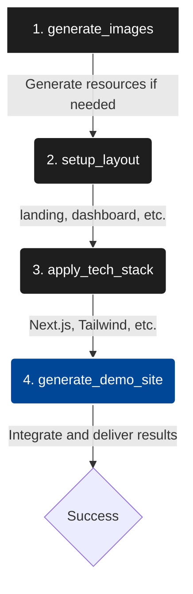

# 리뷰 이벤트(인프런)

> 출처: https://instinctive-spirit-494.notion.site/31f12a10306780389720fe577aca7758

---

본 자료는 인프런 강의를 위한 이벤트 자료입니다.
수강생 여러분의 학습을 위해 공유하는 자료입니다.
참여해주셔서 감사합니다.

*점진적으로 더 많은 소스코드/자료를 제공 드릴 예정입니다.

---

<details><summary><b>SNS 자동화 실습 예제 및 코드 설명 *API로만 하세요(스레드/X)</b></summary>


</details>


---

## 📄 토스 미니앱 Skill 코드

아래는 토스 미니앱을 웹앱 형식으로 구현하는 Skill이며,
간단한 앱은 바로 제작이 가능하도록 설계되어있습니다.

UIUX/애니메이션/컴포넌트 메뉴얼 샘플이 들어있으며
강의 진행 과정에서 기록한 것들입니다.(모두 AI 기록본)
‘참고’ 하시길 바라며

다만 토스미니앱으로 바로 출력되는 게 아니라
디버깅/강의 진행을 위해 어디까지나 PC ‘웹앱’으로 출력되므로
적절하게 변환하셔서 TDS에 맞게 제작해서 출시하시기 바랍니다.

-김프로

### 📑 토스 미니앱 로고 제작 프롬프트


```javascript
아이폰 [APP_THEME: 포켓몬 도감] 아이콘을 1024x1024px 완벽 정사각형 full-bleed 디자인으로
 생성해. [APP_THEME] '피카츄 디즈니 모습' 심볼 중앙에 배치 – 배경은 화면 가장자리 끝까지
 완벽히 꽉 찬 직사각형 순수한 단색(검정/흰색 불가) – 흰색/투명 여백, 그림자 전혀 없음.
 3D hyper-realistic render 스타일, 고대비 선명. 제약: 배경에 객체 없음, 심볼만. 
 글자 완전 금지, iOS 아이콘 최적화.
```
image.png

```javascript
아이폰 [APP_THEME: 퇴직금 계산기 앱] 아이콘을 1024x1024px 완벽 정사각형
 full-bleed 디자인으로 생성해. [APP_THEME] 심볼 '은퇴한 할아버지'중앙에 배치 
 – 배경은 화면 가장자리 끝까지 완전히 꽉 찬 직사각형 순수한 단색(검정/흰색 불가) 
 – 흰색/투명 여백, 테두리, 오목함, 그림자 전혀 없음. 3D hyper-realistic render 스타일, 
 고대비 선명. 제약: 배경 객체 없음, 심볼만. 글자 완전 금지, iOS 아이콘 최적화.
```
image.png


```markdown
---
name: TDS 모바일 카드 피드 앱
description: Toss Design System 기반 모바일 카드 피드 앱 개발 노하우 (스냅 스크롤, 프리미엄 UI, 이미지 최적화)
---

# TDS 모바일 카드 피드 앱 개발 가이드

토스 앱 내 미니앱(Apps-in-Toss) 또는 독립 모바일 웹앱으로 **카드 피드 형태의 콘텐츠 앱**을 만들 때 적용하는 디자인/개발 패턴.

---

## 0. 기술 스택

### 핵심 기술

| 구분 | 기술 | 버전 | 비고 |
|------|------|------|------|
| **Runtime** | React | ^19.x | `react-jsx` 모드 (import 불필요) |
| **Build** | Vite | ^7.x | `@vitejs/plugin-react` 사용 |
| **Language** | TypeScript | ~5.9 | `strict: true`, `verbatimModuleSyntax` |
| **Toss SDK** | `@apps-in-toss/web-framework` | ^1.14 | 토스 미니앱 연동 |
| **Font** | Pretendard Variable | v1.3.9 | CDN dynamic subset |
| **Image Tool** | sharp | ^0.34 | devDependency, WebP 변환용 |
| **CSS** | Vanilla CSS | — | TDS 토큰 기반, 프레임워크 없음 |

### package.json

```json
{
  "type": "module",
  "scripts": {
    "dev": "vite",
    "build": "tsc && vite build",
    "preview": "vite preview"
  },
  "dependencies": {
    "@apps-in-toss/web-framework": "^1.14.1",
    "react": "^19.2.4",
    "react-dom": "^19.2.4"
  },
  "devDependencies": {
    "@types/react": "^19.2.14",
    "@types/react-dom": "^19.2.3",
    "@vitejs/plugin-react": "^5.1.4",
    "sharp": "^0.34.5",
    "typescript": "~5.9.3",
    "vite": "^7.3.1"
  }
}
```

### 프로젝트 초기화

```bash
# 1. Vite + React + TypeScript 프로젝트 생성
npx -y create-vite@latest ./ --template react-ts

# 2. 토스 미니앱 SDK 설치
npm install @apps-in-toss/web-framework

# 3. 이미지 변환 도구 (devDependency)
npm install -D sharp

# 4. 개발 서버 실행
npm run dev
```

### vite.config.ts

```ts
import { defineConfig } from 'vite'
import react from '@vitejs/plugin-react'

export default defineConfig({
    plugins: [react()],
})
```

> `@vitejs/plugin-react` 플러그인이 자동으로 JSX transform을 처리하므로 `import React`가 불필요.

### tsconfig.json 핵심 설정

```json
{
  "compilerOptions": {
    "target": "ES2022",
    "module": "ESNext",
    "jsx": "react-jsx",         // ← React 17+ 자동 JSX (import React 불필요)
    "moduleResolution": "bundler",
    "verbatimModuleSyntax": true, // ← type-only import 강제
    "strict": true,
    "noEmit": true,
    "types": ["vite/client"]     // ← Vite 전용 타입
  },
  "include": ["src"]
}
```

> **중요**: `"jsx": "react-jsx"` 설정이 없으면 `React is not defined` 에러 발생. `"verbatimModuleSyntax": true`일 때는 반드시 `import type { ... }` 구문 사용.

### index.html

```html
<!doctype html>
<html lang="ko">
<head>
  <meta charset="UTF-8" />
  <link rel="icon" href="data:image/svg+xml,<svg xmlns='...'><text>📖</text></svg>" />
  <meta name="viewport" content="width=device-width, initial-scale=1.0, maximum-scale=1.0, user-scalable=no" />
  <meta name="description" content="매일 1분, 랜덤 성경 구절을 만나보세요" />
  <title>1분 성경</title>
</head>
<body>
  <div id="root"></div>
  <script type="module" src="/src/main.tsx"></script>
</body>
</html>
```

> **viewport**: `maximum-scale=1.0, user-scalable=no`로 모바일에서 핀치 줌을 방지하여 앱처럼 동작.

### 엔트리 포인트 (main.tsx)

```tsx
import { StrictMode } from 'react'
import { createRoot } from 'react-dom/client'
import App from './App.tsx'

createRoot(document.getElementById('root')!).render(
    <StrictMode>
        <App />
    </StrictMode>,
)
```

### CSS 로딩 순서

```
main.tsx
  └── App.tsx
        ├── import './styles/tds-tokens.css'  ← ① 디자인 토큰 (최우선)
        ├── import './App.css'                 ← ② 글로벌 레이아웃
        └── 컴포넌트들
              ├── VerseCard.css                ← ③ 컴포넌트별 CSS
              ├── BottomNav.css
              └── LoadingSpinner.css
```

> `tds-tokens.css`에서 Pretendard 폰트 CDN `@import`가 최상단에 위치해야 FOUT(Flash of Unstyled Text) 최소화.

### 데이터 아키텍처

```
public/full_bible.json (31,102 구절)
       ↓ fetch
bibleData.ts
  ├── flattenBible()     → BibleVerse[] (평탄 배열)
  ├── shuffle()           → Fisher-Yates 셔플
  ├── initBibleData()     → 초기화 (1회)
  └── getRandomVerses()   → 커서 기반 페이지네이션 + 이미지 덱 셔플
       ↓
App.tsx (useState + IntersectionObserver)
       ↓
VerseCard.tsx × N (무한 스크롤)
```

---

## 1. 프로젝트 구조

```
src/
├── styles/
│   └── tds-tokens.css        # TDS 디자인 토큰 (색상, 타이포, 그림자, 간격)
├── components/
│   ├── VerseCard.tsx + .css   # 카드 컴포넌트
│   ├── BottomNav.tsx + .css   # 하단 탭 네비게이션
│   └── LoadingSpinner.tsx     # 로딩 인디케이터
├── utils/
│   └── bibleData.ts           # 데이터 로딩 + 셔플 + 페이지네이션
├── App.tsx                    # 메인 앱 (피드 + 무한스크롤)
└── App.css                    # 글로벌 레이아웃
public/
└── images/                    # WebP 최적화 이미지
```

---

## 2. TDS 디자인 토큰 체계

### 필수 변수

```css
:root {
  /* 컬러: 메인 블루 + 보조 앰버/골드 */
  --toss-blue-50 ~ 600
  --toss-amber-50 ~ 700    /* 태그, 장식 요소에 따뜻한 악센트 */
  --toss-gray-50 ~ 900

  /* 타이포: Pretendard 필수 */
  --font-family: 'Pretendard Variable', 'Pretendard', -apple-system, sans-serif;

  /* 3단 그림자 시스템 (깊이 계층화) */
  --shadow-subtle:   0 1px 2px rgba(0,0,0,0.04);
  --shadow-card:     0 4px 16px rgba(0,0,0,0.08), 0 1px 4px rgba(0,0,0,0.04);
  --shadow-elevated: 0 16px 48px rgba(0,0,0,0.12), 0 4px 12px rgba(0,0,0,0.06);

  /* 트랜지션 */
  --transition-spring: 350ms cubic-bezier(0.34, 1.56, 0.64, 1);  /* 바운스 */
  --transition-normal: 250ms cubic-bezier(0.4, 0, 0.2, 1);        /* 매끄러움 */
}
```

### 폰트 로딩

```css
@import url('https://cdn.jsdelivr.net/gh/orioncactus/pretendard@v1.3.9/dist/web/variable/pretendardvariable-dynamic-subset.min.css');
```

---

## 3. 모바일 프레임 레이아웃

### 핵심 원칙
- 데스크탑에서는 **iPhone 비율(375×812)** 프레임으로 시뮬레이션
- 모바일(420px 이하)에서는 프레임 제거, **100dvh** 전체 화면 사용
- `env(safe-area-inset-bottom)`으로 노치/홈바 영역 확보

```css
.mobile-frame {
    width: 375px;
    height: 812px;
    --bottom-nav-height: 64px;
    --card-height: calc(812px - var(--bottom-nav-height));
    border-radius: 36px;
    box-shadow: 0 24px 80px rgba(0,0,0,0.18), inset 0 1px 0 rgba(255,255,255,0.5);
    overflow: hidden;
}

@media (max-width: 420px) {
    .mobile-frame {
        width: 100%; height: 100dvh;
        --card-height: calc(100dvh - var(--bottom-nav-height) - env(safe-area-inset-bottom));
        border: none; border-radius: 0; box-shadow: none;
    }
}
```

### 헤더 여부
- 카드 피드 앱에서는 **헤더 제거**가 더 몰입감 있음 (TDS 필수 아님)
- 헤더가 필요하면 `--header-height`를 추가하고 `--card-height`에 반영

---

## 4. 스냅 스크롤 피드 (릴스/틱톡 스타일)

### 컨테이너

```css
.feed {
    flex: 1;
    overflow-y: scroll;
    scroll-snap-type: y mandatory;          /* 핵심: 세로 필수 스냅 */
    -webkit-overflow-scrolling: touch;       /* iOS 관성 스크롤 */
    overscroll-behavior-y: contain;          /* 브라우저 바운스 방지 */
    scrollbar-width: none;                   /* 스크롤바 숨김 */
}
.feed::-webkit-scrollbar { display: none; }
```

### 카드 아이템

```css
.verse-card {
    height: var(--card-height);              /* 정확히 1화면 = 1카드 */
    scroll-snap-align: start;                /* 카드 시작점에 스냅 */
    scroll-snap-stop: always;                /* 빠른 스와이프도 1장씩 넘김 */
    padding: 24px 20px;                      /* 카드 바깥 여백 (프레임에 안 붙게) */
    box-sizing: border-box;
    display: flex; align-items: center; justify-content: center;
}
```

### 주의사항
- `height`는 반드시 CSS 변수로 계산 (헤더/네비 높이 제외)
- 카드 내부에 `min-height`나 `max-height` 함부로 쓰면 스냅이 틀어짐
- `scroll-snap-stop: always`가 없으면 빠른 플릭에 여러 장이 넘어감

---

## 5. 3D 애니메이션 & 프리미엄 컴포넌트

### 3D 카드 플립 패턴 (TaroCard)
카드의 앞/뒷면을 별도 요소로 구성하고 `backface-visibility: hidden`으로 겹쳐서 회전시키는 방식.

```tsx
<div className={`card-inner ${isFlipped ? 'flipped' : ''}`}>
    <div className="card-face card-front">...</div>
    <div className="card-face card-back">...</div>
</div>
```

```css
.card-inner {
    position: relative;
    width: 100%; height: 100%;
    transition: transform 0.6s cubic-bezier(0.4, 0, 0.2, 1);
    transform-style: preserve-3d;
}
.card-inner.flipped { transform: rotateY(180deg); }

.card-face {
    position: absolute;
    width: 100%; height: 100%;
    backface-visibility: hidden;  /* 뒷면일 때 숨김 */
    border-radius: 20px;
    overflow: hidden;
}
.card-back { transform: rotateY(180deg); } /* 뒷면은 미리 180도 회전 */
```

### 인트로 3D 회전 및 백페이스 스위칭 (IntroCard)
카드가 회전하는 도중 뒷면이 정면을 향할 때(180도 근처) 이미지를 교체하여 끊김 없는 무한 변칙 회전을 구현.

```tsx
// Framer Motion의 onChange를 이용하여 각도 추적
useAnimationFrame((time) => {
    const rotation = (time / 20) % 360;
    setYRotation(rotation);
    
    // 180도(뒷면)일 때 이미지 데이터 교체
    if (Math.abs(rotation - 180) < 5 && !isSwapped) {
        setCurrentImage(nextImage);
        setIsSwapped(true);
    } else if (Math.abs(rotation - 0) < 5) {
        setIsSwapped(false);
    }
});
```

### 프리미엄 글래스모피즘 CTA 버튼
단순한 색상이 아닌, 블러와 테두리 글로우, 내부 하이라이트를 조합한 하이엔드 버튼.

```css
.premium-btn {
    backdrop-filter: blur(20px);
    background: rgba(49, 130, 246, 0.1);
    border: 1.5px solid rgba(49, 130, 246, 0.3);
    box-shadow: 
        0 8px 32px rgba(49, 130, 246, 0.2),
        inset 0 0 0 1px rgba(255, 255, 255, 0.05); /* 인셋 하이라이트 */
}

/* 마스크를 이용한 내부 광택 효과 */
.premium-btn::before {
    content: '';
    position: absolute;
    top: 0; left: -100%;
    width: 100%; height: 100%;
    background: linear-gradient(90deg, transparent, rgba(255,255,255,0.2), transparent);
    transition: 0.6s;
}
.premium-btn:hover::before { left: 100%; }
```

### 이미지 프리로딩 (Performance)
3D 애니메이션 중 끊김을 방지하기 위해 `Image` 객체를 미리 생성하여 캐싱.

```ts
useEffect(() => {
    images.forEach(src => {
        const img = new Image();
        img.src = src;
    });
}, []);
```

---

## 6. 프리미엄 카드 디자인 패턴

### 다층 그림자 + 인셋 하이라이트

```css
.card {
    box-shadow:
        0 20px 60px rgba(0,0,0,0.10),     /* 깊은 그림자 */
        0 8px 24px rgba(0,0,0,0.06),      /* 중간 확산 */
        0 2px 6px rgba(0,0,0,0.04),       /* 가까운 그림자 */
        inset 0 1px 0 rgba(255,255,255,0.8); /* 상단 하이라이트 */
    border-radius: 28px;
}
```

### 이미지 → 텍스트 그라디언트 페이드

```tsx
<div className="image-area">
    
    <div className="image-fade" />  {/* 핵심: 별도 오버레이 div */}
</div>
```

```css
.image-fade {
    position: absolute; bottom: 0; left: 0; right: 0;
    height: 80px;
    background: linear-gradient(
        to bottom,
        rgba(255,255,255,0) 0%,
        rgba(255,255,255,0.6) 50%,
        rgba(255,255,255,1) 100%
    );
    pointer-events: none;
}
```

### 큰따옴표 장식 (인용문 카드)

```css
.quote-mark {
    font-family: 'Georgia', serif;
    font-size: 44px; font-weight: 700;
    color: var(--toss-amber-200);     /* 골드 톤 */
    line-height: 0.7;
    user-select: none;
}
```

### 태그(출처 뱃지) 디자인

```css
.tag {
    font-size: 11px; font-weight: 700;
    color: var(--toss-amber-700);
    background: linear-gradient(135deg, var(--toss-amber-50), #fff5d4);
    padding: 5px 12px;
    border-radius: 99px;
    border: 1px solid var(--toss-amber-100);
    box-shadow: 0 1px 3px rgba(255,193,7,0.12);  /* 미세 글로우 */
}
```

### 터치 인터랙션 (마이크로 애니메이션)

```css
.card {
    transition: transform var(--transition-spring), box-shadow var(--transition-normal);
}
.card:active {
    transform: scale(0.97);  /* 눌림 효과 */
    box-shadow: var(--shadow-card);  /* 그림자 축소 */
}
```

---

## 6. 글래스모피즘 내비게이션

```css
.bottom-nav {
    background: rgba(255,255,255,0.82);
    backdrop-filter: saturate(200%) blur(24px);
    -webkit-backdrop-filter: saturate(200%) blur(24px);
    box-shadow: 0 -1px 0 rgba(255,255,255,0.6), 0 -6px 24px rgba(0,0,0,0.03);
}

/* 활성 탭: 반투명 알약 배경 */
.nav-item--active {
    color: var(--toss-blue-500);
    background: rgba(49, 130, 246, 0.08);
    border-radius: 14px;
}

/* 아이콘 스프링 바운스 */
.nav-item--active .icon {
    transform: scale(1.12);
    transition: transform var(--transition-spring);
}

/* 터치 피드백 */
.nav-item:active { transform: scale(0.90); }
```

---

## 7. 이미지 최적화

### WebP 변환 스크립트 (convert-images.cjs)

```js
const sharp = require('sharp');
const fs = require('fs');
const path = require('path');

const INPUT_DIR = './원본이미지폴더';
const OUTPUT_DIR = './public/images';

fs.mkdirSync(OUTPUT_DIR, { recursive: true });

const files = fs.readdirSync(INPUT_DIR).filter(f => /\.(jpg|jpeg|png)$/i.test(f));

for (const file of files) {
    const name = path.parse(file).name;
    sharp(path.join(INPUT_DIR, file))
        .webp({ quality: 85 })  // 품질 85로 용량 60%+ 절감
        .toFile(path.join(OUTPUT_DIR, `${name}.webp`));
}
```

> **주의**: `.cjs` 확장자 사용 (ESM 프로젝트에서 CommonJS 스크립트 실행 시)

### 랜덤 이미지 배치 (덱 셔플)

```ts
// 10개 이미지를 중복 없이 무작위 순서로 할당
let imageDeck = shuffle([0,1,2,3,4,5,6,7,8,9]);

for (let i = 0; i < verses.length; i++) {
    if (i > 0 && i % 10 === 0) {
        imageDeck = shuffle([0,1,2,3,4,5,6,7,8,9]); // 10개마다 리셔플
    }
    verses[i].imageId = imageDeck[i % 10];
}
```

---

## 8. 무한 스크롤 (IntersectionObserver)

```tsx
// 센티넬: 리스트 맨 아래에 1px 요소
<div ref={sentinelRef} className="feed__sentinel" />

// Observer: 센티넬이 화면에 들어오면 추가 로드
const observer = new IntersectionObserver(
    entries => { if (entries[0].isIntersecting) loadMore(); },
    { threshold: 0.1 }
);
observer.observe(sentinelRef.current);
```

### 데이터 페이지네이션 (커서 기반 + 리셔플)

```ts
export function getRandomVerses(cursor, count = 20) {
    if (cursor >= shuffledVerses.length) {
        shuffledVerses = shuffle(flattenedVerses); // 전체 소진 시 리셔플
        cursor = 0;
    }
    return { verses: shuffledVerses.slice(cursor, cursor + count), nextCursor: cursor + count };
}
```

---

## 9. 흔한 실수 & 해결법

| 실수 | 해결 |
|------|------|
| 카드가 프레임 모서리에 딱 붙음 | `.verse-card`에 `padding + box-sizing: border-box` 필수 |
| 이미지가 잘림 | `object-fit: cover` + 적절한 `aspect-ratio` 또는 `flex` 비율 |
| 이미지→텍스트가 뚝 끊김 | 별도 `<div>` 오버레이에 `linear-gradient(transparent → white)` |
| 태그가 텍스트처럼 보임 | `border-radius: 99px` + 배경색 + `font-weight: 700` + 미세 border |
| 스크롤 시 여러 장 넘어감 | `scroll-snap-stop: always` 추가 |
| iOS에서 스크롤 뻣뻣함 | `-webkit-overflow-scrolling: touch` 추가 |
| 하단 Nav가 배경과 구분 안 됨 | 글래스모피즘 (`backdrop-filter: blur`) + 상단 그림자 |
| 모바일에서 확대/축소됨 | `<meta name="viewport" content="... maximum-scale=1.0, user-scalable=no">` |
| ESM 프로젝트에서 sharp 스크립트 에러 | 파일명을 `.cjs`로 변경 |
| 카드 내부 이미지가 양옆 여백 때문에 꽉 안 찰 때 | `.feed-card-wrapper`의 padding을 끄고(`0`) `.premium-card`에 `border-radius: 28px` 적용, 내부 이미지는 `object-fit: cover` 사용 |

---

## 10. 고급 인터랙션 제어 (Scroll Validation & State Reset)

### 필수 답변 스크롤 제어 (Strict Scroll Validation)
사용자가 이전 문항에 답을 하지 않으면 다음 카드로 넘어가지 못하게 막는 기법.

**1) CSS 제어**: 아직 답변 완료 전이면 `overflow: hidden` 클래스를 부여하지만 iOS 바운스 효과로 인해 완벽히 막히진 않음.
**2) 스크롤 위치 강제 고정 (권장)**:
```tsx
const maxAllowedIndex = Object.keys(answers).length + 1;

const handleScroll = (e) => {
    const feedNode = e.currentTarget;
    const cardHeight = feedNode.clientHeight;
    const currentIndex = Math.round(feedNode.scrollTop / cardHeight);

    if (currentIndex > maxAllowedIndex) {
        // 강제 스크롤 원복
        feedNode.scrollTop = maxAllowedIndex * cardHeight;
        showToast('이전 질문에 먼저 답해주세요!');
    }
};
// <div className="feed" onScroll={handleScroll}> 
```

### 토스트 (Toast) UI 피드백
사용자의 잘못된 동작에 대해 방해되지 않으면서 확실한 피드백을 주기 위해 상단 토스트를 띄웁니다.
```css
.toast-container {
    position: absolute;
    top: 60px; /* 상단에서 등장 */
    left: 0; right: 0;
    z-index: 100;
    pointer-events: none;
}
.toast {
    animation: toast-in-down var(--transition-spring) forwards;
}
```

### 컴포넌트 간 상태 동기화 (재도전 리셋)
React로 개발 시, 부모의 `answers` 상태를 초기화해도 자식 컴포넌트(`QuestionCard`)가 들고 있는 `selected` state (활성화 버튼 UI)는 그대로 남아있는 버그가 흔합니다.

부모에서 `selectedAnswer`를 명시적으로 prop으로 내려주고 자식에서 `useEffect`로 동기화해야 완벽한 리셋이 가능합니다.
```tsx
// QuestionCard.tsx
useEffect(() => {
    // 부모 리셋으로 undefined가 들어오면 자식도 로컬 상태 초기화
    if (!selectedAnswer) {
        setSelected(null);
    }
}, [selectedAnswer]);
```

## 10. 디자인 품질 체크리스트 (9.9/10 기준)

> **⚠️ 절대 규칙**: 기본 수준의 단순한 디자인(1px border, 단일 기본 그림자, 밋밋한 흰색 폼 등)은 절대 하지 않는다. 항상 다층 그림자, 대각선 네온 섀도우, 글래스모피즘, 인너 섀도우 등 프리미엄 스타일을 고수할 것.

- [ ] 입력 폼(Input)이나 카드(Card)가 단순하지 않은가? (예: `box-shadow: 12px -12px 32px ...` 같은 대각선 그림자로 엣지감 부여)
- [ ] 다층 그림자 (3겹 이상) 적용했는가?
- [ ] 카드에 `inset` 하이라이트가 있는가?
- [ ] 이미지→텍스트 전환에 그라디언트 페이드가 있는가?
- [ ] 인용문 장식 요소 ('"' 등)가 있는가?
- [ ] 태그에 그라디언트 배경 + 미세 글로우가 있는가?
- [ ] 터치 시 `scale` 마이크로 애니메이션이 있는가?
- [ ] 피드 배경이 단색이 아닌 그라디언트인가?
- [ ] Nav에 글래스모피즘이 적용되었는가?
- [ ] 활성 탭에 시각적 구분 (알약 배경)이 있는가?
- [ ] 스크롤바가 숨겨져 있는가?
- [ ] Pretendard 폰트가 로딩되고 있는가?
- [ ] 색상이 2종 이상 (메인 + 보조 악센트)인가?

```


---

## 📄 VNC 메뉴얼(MD)


> 💡 ****
VNC 연결 시 아래 세팅대로 하시면
오픈클로가 잘 읽고 알아서 열어줍니다.
*제가 실제 쓰는 메뉴얼입니다.

```markdown
# noVNC 설정 가이드 (Ubuntu + Chromium)

## 개요
이 가이드는 Ubuntu 서버에서 noVNC를 사용하여 원격 브라우저 GUI에 접속하는 방법을 설명합니다.

## 1. 필수 패키지 설치

```bash
sudo apt update
sudo apt install -y chromium-browser novnc websockify x11vnc xvfb
```

## 2. 가상 디스플레이 및 브라우저 시작 스크립트

다음 스크립트를 `start-vnc-browsers.sh`로 저장하세요:

```bash
#!/bin/bash

# 기존 프로세스 정리
pkill -f "Xvfb :1" 2>/dev/null
pkill -f "Xvfb :2" 2>/dev/null
pkill -f "x11vnc.*:1" 2>/dev/null
pkill -f "x11vnc.*:2" 2>/dev/null
pkill -f "websockify.*6080" 2>/dev/null
pkill -f "websockify.*6081" 2>/dev/null
pkill -f "chromium.*--remote-debugging-port=9222" 2>/dev/null
pkill -f "chromium.*--remote-debugging-port=9223" 2>/dev/null

sleep 2

# 가상 디스플레이 시작
echo "Starting virtual display 1..."
Xvfb :1 -screen 0 1920x1080x24 -ac +extension GLX +render -noreset &
sleep 3

echo "Starting virtual display 2..."
Xvfb :2 -screen 0 1920x1080x24 -ac +extension GLX +render -noreset &
sleep 3

# 디스플레이 준비 대기
echo "Waiting for displays..."
sleep 5

# Chromium 시작 (Chromium 사용!)
echo "Starting Chromium on display 1..."
DISPLAY=:1 /snap/bin/chromium --no-sandbox --disable-gpu --remote-debugging-port=9222 --disable-dev-shm-usage --user-data-dir=/tmp/chromium1 &
sleep 5

echo "Starting Chromium on display 2..."
DISPLAY=:2 /snap/bin/chromium --no-sandbox --disable-gpu --remote-debugging-port=9223 --disable-dev-shm-usage --user-data-dir=/tmp/chromium2 &
sleep 5

# x11vnc 서버 시작
echo "Starting x11vnc for display 1..."
x11vnc -display :1 -rfbport 5900 -forever -shared -nopw -quiet &
sleep 3

echo "Starting x11vnc for display 2..."
x11vnc -display :2 -rfbport 5901 -forever -shared -nopw -quiet &
sleep 3

# websockify 시작 (중요: --web=/usr/share/novnc 옵션 필수!)
echo "Starting websockify for display 1 (port 6080)..."
websockify --web=/usr/share/novnc 6080 localhost:5900 &
sleep 2

echo "Starting websockify for display 2 (port 6081)..."
websockify --web=/usr/share/novnc 6081 localhost:5901 &
sleep 2

echo "==================================="
echo "Setup complete!"
echo "==================================="
echo "Display 1: http://localhost:6080/vnc.html"
echo "Display 2: http://localhost:6081/vnc.html"
echo "CDP Port 1: http://localhost:9222"
echo "CDP Port 2: http://localhost:9223"
echo "==================================="

# 공용 IP 가져오기
PUBLIC_IP=$(curl -s ifconfig.me || curl -s icanhazip.com || echo "localhost")
echo "Public IP: $PUBLIC_IP"
echo "Public URLs:"
echo "Display 1: http://$PUBLIC_IP:6080/vnc.html"
echo "Display 2: http://$PUBLIC_IP:6081/vnc.html"
```

## 3. 방화벽 설정

```bash
sudo ufw allow 6080/tcp
sudo ufw allow 6081/tcp
sudo ufw allow 9222/tcp
sudo ufw allow 9223/tcp
sudo ufw reload
```

## 4. 실행

```bash
chmod +x start-vnc-browsers.sh
./start-vnc-browsers.sh
```

## 5. 접속

### 외부 접속
```
http://<SERVER_IP>:6080/vnc.html
http://<SERVER_IP>:6081/vnc.html
```

### SSH 터널링 (더 안전한 방법)
```bash
ssh -L 6080:localhost:6080 -L 6081:localhost:6081 root@<SERVER_IP>
```

SSH 연결 후 브라우저에서:
```
http://localhost:6080/vnc.html
http://localhost:6081/vnc.html
```

## ⚠️ 중요: 웹 옵션 필수

`websockify`를 실행할 때 **반드시 `--web=/usr/share/novnc` 옵션을 포함**해야 합니다!

❌ 틀린 방법:
```bash
websockify 6080 localhost:5900
# 이렇게 하면 405 Method Not Allowed 에러 발생
```

✅ 올바른 방법:
```bash
websockify --web=/usr/share/novnc 6080 localhost:5900
# 이렇게 해야 noVNC 웹 인터페이스 제공
```

## 6. CDP 포트 사용

Chrome DevTools Protocol 포트로 프로그래밍 방식 제어 가능:
- 브라우저 1: `http://<SERVER_IP>:9222`
- 브라우저 2: `http://<SERVER_IP>:9223`

## 7. Chromium vs Chrome

**Chromium**을 사용합니다!
- 설치: `chromium-browser` 패키지 (snap으로 설치됨)
- 경로: `/snap/bin/chromium`
- 오픈 소스 버전으로, Google Chrome과 거의 동일

## 8. 문제 해결

### 405 Method Not Allowed 에러
- `--web=/usr/share/novnc` 옵션 확인
- noVNC 패키지가 설치되어 있는지 확인: `dpkg -l novnc`

### 화면이 보이지 않음
- Xvfb가 실행 중인지 확인: `ps aux | grep Xvfb`
- Chromium이 실행 중인지 확인: `ps aux | grep chromium`

### VNC 연결 실패
- x11vnc가 실행 중인지 확인: `ps aux | grep x11vnc`
- websockify가 실행 중인지 확인: `ps aux | grep websockify`

## 9. 클라우드 방화벽

외부에서 접속할 경우, 클라우드 제공자(Contabo, AWS, GCP 등)의 보안 그룹/방화벽에서도 다음 포트를 열어야 합니다:
- 6080/tcp (브라우저 1 VNC)
- 6081/tcp (브라우저 2 VNC)
- 9222/tcp (브라우저 1 CDP)
- 9223/tcp (브라우저 2 CDP)

## 10. 자동 시작 (선택)

서버 재시작 시 자동 시작하려면 systemd 서비스로 등록:

```bash
sudo nano /etc/systemd/system/vnc-browsers.service
```

```ini
[Unit]
Description=VNC Browsers Service
After=network.target

[Service]
Type=simple
User=root
WorkingDirectory=/root/.openclaw/workspace
ExecStart=/root/.openclaw/workspace/start-vnc-browsers.sh
Restart=always

[Install]
WantedBy=multi-user.target
```

```bash
sudo systemctl enable vnc-browsers
sudo systemctl start vnc-browsers
```

---

## 11. 실제 사용 방법 (성공 사례)

### 브라우저 설치 (Google Chrome Stable)

```bash
# Google Chrome APT repository 추가
wget -q -O - https://dl.google.com/linux/linux_signing_key.pub | gpg --dearmor -o /usr/share/keyrings/google-chrome.gpg
echo "deb [arch=amd64 signed-by=/usr/share/keyrings/google-chrome.gpg] http://dl.google.com/linux/chrome/deb/ stable main" > /etc/apt/sources.list.d/google-chrome.list
apt update
apt install -y google-chrome-stable
```

### VNC별 브라우저 실행 (중복 없이 하나씩)

```bash
# Display :1 (VNC 6080) - Chromium CDP 9222
DISPLAY=:1 chromium-browser --remote-debugging-port=9222 --no-sandbox --user-data-dir=/tmp/chrome1 --disable-dev-shm-usage > /tmp/chrome1.log 2>&1 &

# Display :2 (VNC 6081) - Chromium CDP 9223
DISPLAY=:2 chromium-browser --remote-debugging-port=9223 --no-sandbox --user-data-dir=/tmp/chrome2 --disable-dev-shm-usage > /tmp/chrome2.log 2>&1 &
```

### CDP WebSocket으로 페이지 네비게이션

```bash
# Python websockets 모듈 필요
apt install -y python3-websockets
```

```python
import asyncio
import websockets
import json

async def navigate_to_threads(ws_url):
    async with websockets.connect(ws_url) as ws:
        # Page domain 활성화
        await ws.send(json.dumps({"id": 1, "method": "Page.enable"}))
        await ws.recv()
        
        # 페이지 이동
        await ws.send(json.dumps({"id": 2, "method": "Page.navigate", "params": {"url": "https://threads.com"}}))
        result = await ws.recv()
        print(json.dumps(json.loads(result), indent=2))

# 실행
asyncio.run(navigate_to_threads("ws://localhost:9222/devtools/page/<TAB_ID>"))
```

### 탭 ID 확인

```bash
curl -s http://localhost:9222/json/list | python3 -m json.tool
```

### 중복 브라우저 정리

```bash
# 기존 중복 프로세스 확인
ps aux | grep google-chrome | grep -v grep | grep -v crashpad

# 중복된 메인 프로세스 종료 (예: PID 19892)
kill <PID>
```

### 설정 요약

| 항목 | Display 1 (VNC 6080) | Display 2 (VNC 6081) |
|------|---------------------|---------------------|
| DISPLAY | :1 | :2 |
| VNC Port | 6080 | 6081 |
| CDP Port | 9222 | 9223 |
| user-data-dir | /tmp/chrome1 | /tmp/chrome2 |
| 브라우저 | Google Chrome Stable | Google Chrome Stable |
| 제어 모듈 | python3-websockets | python3-websockets |

### 사용한 모듈 및 도구

- **브라우저**: Chromium (snap package)
- **CDP 제어**: python3-websockets
- **VNC**: noVNC + websockify + x11vnc
- **가상 디스플레이**: Xvfb

---

## 요약

✅ Chromium 사용 (snap package)
✅ python3-websockets로 CDP 제어
✅ user-data-dir로 중복 방지
✅ 각 VNC별로 하나의 브라우저만 유지
✅ noVNC + websockify + x11vnc + Xvfb 조합
✅ `--web=/usr/share/novnc` 옵션 필수
✅ 외부 접속: 포트 방화벽 개필요
✅ SSH 터널링 사용 권장 (더 안전)

---

## ⚠️ IMPORTANT: Never Close Browsers

**VNC can be stopped, but browsers must NEVER be closed.**

The automated posting systems (Threads, X, ERP) rely on the browsers running continuously via CDP (Chrome DevTools Protocol). If you close the browsers:

- Scheduled posts will fail
- X posts will not be published
- ERP data collection will stop
- All automation will break

**Safe to stop:**
- VNC (x11vnc, websockify)
- You can reconnect later

**NEVER stop:**
- Xvfb (virtual displays :1, :2)
- Chromium browsers (CDP ports 9222, 9223)

**If browsers crash accidentally, restart them immediately:**
```bash
# Restart browser on display :1
DISPLAY=:1 chromium-browser --remote-debugging-port=9222 --no-sandbox --user-data-dir=/tmp/chrome1 --disable-dev-shm-usage &
```

```


---

## 📄 스레드 자동화 코드(API 사용을 권장합니다)


```javascript
const { chromium } = require('playwright');

/**
 * [수강생용] Threads 자동 포스팅 예제 스크립트
 * 
 * 이 스크립트는 Threads 브라우저 버전에 접속하여 
 * 게시 버튼을 누르고 단축키(Ctrl+Enter)로 발행하는 로직을 보여줍니다.
 */

async function postToThreads(text) {
    // 1. 이미 실행 중인 크롬 브라우저에 접속 (9222 포트)
    const browser = await chromium.connectOverCDP('http://127.0.0.1:9222');
    const context = browser.contexts()[0];

    // 2. 기존 스레드 탭 확인 또는 첫 번째 탭 사용
    let page = context.pages().find(p => p.url().includes('threads.net'));
    if (!page) {
        page = context.pages()[0];
    }
    await page.bringToFront();

    // 3. 내 프로필 페이지로 이동 (이미 로그인된 상태 가정)
    // 예: threads.net/@계정명
    await page.goto('https://www.threads.net/', { waitUntil: 'domcontentloaded' });
    await page.waitForTimeout(3000);

    // 4. "게시(Post)" 버튼 찾기
    // Threads는 구조가 상시 변하므로 텍스트 기반으로 버튼을 찾습니다.
    console.log('게시 버튼 찾는 중...');
    await page.evaluate(() => {
        const btns = Array.from(document.querySelectorAll('[role="button"], button, a'));
        const postBtn = btns.find(el =>
            ['게시', 'Post', 'Start a thread'].includes((el.getAttribute('aria-label') || el.textContent || '').trim())
        );
        if (postBtn) postBtn.click();
    });

    // 5. 입력창(Textbox) 대기 및 텍스트 입력
    console.log('입력창 대기 중...');
    const textbox = await page.waitForSelector('[role="textbox"], [contenteditable="true"]', { timeout: 10000 });

    await textbox.click({ force: true });
    console.log('텍스트 입력 시작');
    await textbox.type(text, { delay: 10 });

    // 6. 발행하기 (Ctrl + Enter 단축키 사용)
    // 마우스 클릭보다 단축키가 더 확실할 때가 많습니다.
    console.log('발행 단축키 전송 (Ctrl+Enter)');
    await page.keyboard.down('Control');
    await page.keyboard.press('Enter');
    await page.keyboard.up('Control');

    console.log('발행 완료 대기 (5초)');
    await page.waitForTimeout(5000);

    return true;
}

// 스크립트 직접 실행 시 테스트 코드
if (require.main === module) {
    const testText = '스레드 자동화 테스트 중입니다! 🧵 #Playwright';
    postToThreads(testText)
        .then(() => console.log('작업 완료'))
        .catch(err => console.error('에러:', err));
}

```


---

## 📄 X 자동화 코드


```javascript
const { chromium } = require('playwright');

/**
 * [수강생용] X(Twitter) 자동 포스팅 예제 스크립트
 * 
 * 이 스크립트는 이미 로그인된 브라우저(Remote Debugging)에 접속하여
 * X.com에 접속 후 포스팅을 하는 핵심 로직을 보여줍니다.
 */

async function postToX(text) {
    // 1. 이미 실행 중인 크롬 브라우저에 접속 (CDP 사용)
    // 실행 커맨드 예시: chrome.exe --remote-debugging-port=9222
    const browser = await chromium.connectOverCDP('http://127.0.0.1:9222');

    // 2. 브라우저 컨텍스트 가져오기 (첫 번째 컨텍스트 사용)
    const context = browser.contexts()[0];

    // 3. 기존에 열려있는 X(twitter) 탭이 있는지 확인
    let page = context.pages().find(p => p.url().includes('x.com'));

    if (page) {
        console.log('기존 X 탭을 사용합니다.');
        await page.bringToFront(); // 탭을 앞으로 가져오기
    } else {
        console.log('새 탭을 생성합니다.');
        page = await context.newPage();
    }

    // 4. X 홈으로 이동
    console.log('X 홈으로 이동 중...');
    await page.goto('https://x.com/home', { waitUntil: 'domcontentloaded' });

    // 페이지 로딩 대기 (네트워크 환경에 따라 조절)
    await page.waitForTimeout(3000);

    // 5. 트윗 작성 박스 찾기 및 클릭
    // [data-testid="tweetTextarea_0"]는 X의 트윗 입력창을 식별하는 고유 속성입니다.
    const tweetBox = page.locator('[data-testid="tweetTextarea_0"]').first();
    await tweetBox.click();
    console.log('트윗 박스 클릭 완료');

    // 6. 텍스트 입력
    // delay 옵션을 주어 사람처럼 타이핑하는 효과를 낼 수 있습니다.
    console.log('텍스트 입력 중:', text);
    await tweetBox.type(text, { delay: 50 });
    await page.waitForTimeout(1000);

    // 7. Post(게시) 버튼 클릭
    // evaluate를 사용하여 브라우저 내부에서 'Post' 텍스트를 가진 버튼을 직접 찾아 클릭합니다.
    console.log('Post 버튼 클릭 시도');
    const clicked = await page.evaluate(() => {
        const buttons = Array.from(document.querySelectorAll('button, [role="button"]'));
        const postBtn = buttons.find(btn => (btn.textContent || '').trim() === 'Post');
        if (postBtn) {
            postBtn.click();
            return true;
        }
        return false;
    });

    if (clicked) {
        console.log('게시 성공! (네트워크 처리를 위해 5초간 대기)');
        await page.waitForTimeout(5000);
    } else {
        console.log('Post 버튼을 찾지 못했습니다.');
    }

    return clicked;
}

// 스크립트 직접 실행 시 테스트 코드
if (require.main === module) {
    const testText = 'Hello Playwright! 🤖 #Automation';
    postToX(testText)
        .then(success => console.log('결과:', success ? '성공' : '실패'))
        .catch(err => console.error('에러 발생:', err));
}

```


---

## 📄 스레드 자동 발행용 프롬프트 예시

아래는 제가 실제 쓰고 있는 프롬프트 예시입니다.
이렇게 프롬프트를 쳐서 AI API를 호출하면,
여성 타겟으로 하는 운세 관련 콘텐츠를 뽑을 수 있습니다.
프롬프트는 구조가 중요하고 줄바꿈 등도 하나하나 전부 세팅해주어야 합니다.
당연히 직접 세팅하는 게 아니라, AI에게 미세하게 잘 작성하라고 명령해야 합니다.

> 💡 ****


---

## 📄 스레드 계정 무한 생성(인스타 계정)

갤럭시 폰에서 지메일 계정 생성
-> 설정에서 계정 만들기 하시면 무한 이메일 생성 가능합니다
PC에선 휴대폰 개수당 제한있어서 안 되구요
모바일에선 지문 인식하면 계속 생성 됩니다.
인스타/스레드 계정 연동이고
만약 봇으로 인식 돼 차단 당하면 스레드만 날아갑니다
인스타는 안 날아갑니다.
차단 당하기 전에, 인스타/스레드 뿐만 아니라
모든 SNS 계정은 기본적으로 봇 차단을 위해 ‘예열시간’이 필요합니다.

따라서 계정 미리 만들어두고 글 몇개 써놓고
며칠 뒤에 시도하세요. 안전한 건 2주 정도지만,
실제로 며칠 뒤에 해도 문제 없었습니다.


---

## 📄 오픈클로: 본인 스레드 수집 코드


### 최근 글 찾기 예제(스크롤하며 “방금/몇 분 전” 탐색)
아래 코드는 프로필에서 링크들을 훑고, “방금”, “1분”, “2분”… 같은 텍스트를 기준으로 최근 글을 찾습니다.

```javascript
const { chromium } = require('playwright');
const fs = require('fs');

const LOG = '/root/.openclaw/workspace/tmp-moltbot/workspace/threads_find_recent_post.log';
fs.writeFileSync(LOG, '');
const log = (m) => fs.appendFileSync(LOG, `[${new Date().toISOString()}] ${m}\n`);

const RECENT_REGEX = /(\b\d+\s*분\b)|(방금)|(1\s*분)|(2\s*분)|(3\s*분)|(4\s*분)|(5\s*분)/; // <= 5분

(async () => {
	const browser = await chromium.connectOverCDP('http://127.0.0.1:9222/');
	const page = browser.contexts()[0].pages()[0];

	await page.goto('https://www.threads.com/본인 프로필 링크', { waitUntil: 'domcontentloaded' });
	await page.waitForTimeout(3000);

	let found = '';
	for (let i = 0; i < 10; i++) {
		const items = await page.evaluate(() => {
			const links = Array.from(document.querySelectorAll('a'))
				.filter(a => /\/post\//.test(a.getAttribute('href') || ''))
				.map(a => ({ href: a.href, text: (a.innerText || '').trim() }));
			return links.slice(0, 20);
		});
		const recent = items.find(it => RECENT_REGEX.test(it.text));
		log(`SCROLL_${i + 1}_ITEMS=${items.map(it => it.text).join(' | ')}`);
		if (recent) { found = recent.href; log(`FOUND=${found}`); break; }
		await page.evaluate(() => window.scrollBy(0, window.innerHeight));
		await page.waitForTimeout(2000);
	}
	console.log('RECENT_POST', found || 'NOT_FOUND');
})();
```


---

## 📄 오픈클로: 스레드 모니터링 코드(추가)


> 💡 ****

### 📑 SKILL.md

Threads 피드 스캔/댓글 수집 스킬
환경

---
스크립트
위치: /root/.openclaw/workspace/tmp-moltbot/threads_spy_scan50.js

---
스캔 절차
1. 피드 링크 수집 (50개)

```plain text
// 홈에서 /post/ 링크 수집
const links = await page.evaluate(() => {
  const anchors = Array.from(document.querySelectorAll('a[href*="/post/"]'));
  return anchors.map(a => ({ url: a.href, text: a.innerText }));
});

// 스크롤하며 추가 링크 수집
while (allLinks.length < 50) {
  await page.evaluate(() => window.scrollBy(0, window.innerHeight * 2));
  await page.waitForTimeout(1500);
  // 링크 수집 반복
}
```

---
2. 각 포스트 방문 → 본문/댓글 수집

```plain text
await page.goto(postUrl, { waitUntil: 'domcontentloaded' });
await page.waitForTimeout(2000);

// 스크롤로 댓글 영역 로드
await page.evaluate(() => {
  for (let i = 0; i < 5; i++) window.scrollBy(0, 400);
});
```

---
3. 본문 수집

```plain text
const bodyText = await page.evaluate(() => document.body.innerText || '');
const shortText = bodyText.substring(0, 500);
```

---
4. 키워드 매칭

```plain text
const KEYWORDS = ['코딩', '깃', '바이브', '바이브코딩', '자동화', '클로드봇', '몰트봇', 'AI', 'GPT', '개발', '코드', '프로그래밍'];

const matchedKeywords = KEYWORDS.filter(kw =>
  bodyText.toLowerCase().includes(kw.toLowerCase())
);
```

---
5. 댓글 수집 (핵심 로직)
기술: DOM 내 텍스트 파싱 (마커 기반)
원리:
* Threads의 document.body.innerText에는 본문 + 댓글이 모두 포함
* "인기순" 또는 "활동 보기" 마커 이후에 댓글이 위치
* 댓글 패턴: [사용자명, 시간, 댓글내용, 좋아요수]

```plain text
const firstComment = await page.evaluate(() => {
  const allText = document.body.innerText;

  // 댓글 영역 시작 마커 찾기
  const markers = ['인기순', '활동 보기', 'Newest', 'Top'];
  let startIndex = -1;

  for (const marker of markers) {
    const idx = allText.indexOf(marker);
    if (idx !== -1) {
      startIndex = idx + marker.length;
      break;
    }
  }

  if (startIndex === -1) return null;

  // 마커 이후 텍스트 파싱
  const afterMarker = allText.substring(startIndex).trim();
  const lines = afterMarker.split('\n').map(l => l.trim()).filter(l => l);

  // 첫 줄이 마커면 스킵
  let startIdx = 0;
  if (lines[0] && markers.includes(lines[0])) {
    startIdx = 1;
  }

  if (lines.length >= 3 + startIdx) {
    const username = lines[startIdx];      // 사용자명
    const time = lines[startIdx + 1];      // 시간
    let commentLines = [];

    // 댓글 내용 수집 (숫자만 있는 줄 = 좋아요 수 = 종료)
    for (let i = startIdx + 2; i < lines.length; i++) {
      const line = lines[i];
      if (/^\d+$/.test(line)) break;
      commentLines.push(line);
    }

    return {
      username,
      time,
      content: commentLines.join(' ').substring(0, 200)
    };
  }

  return null;
});
```

---
6. 좋아요 클릭

```plain text
if (matchedKeywords.length > 0) {
  await page.evaluate(() => {
    const likeBtn = document.querySelector('[aria-label="Like"], [aria-label="좋아요"]');
    if (likeBtn) {
      const clickable = likeBtn.closest('button, [role="button"], a') || likeBtn;
      clickable.click();
    }
  });
}
```

---
로그 형식

```plain text
[2026-02-22T09:00:00.000Z] POST_1: https://www.threads.com/@xxx/post/xxx | 키워드: AI,코딩 | 좋아요: true
[2026-02-22T09:00:00.100Z] 본문: 55만명이 본 Claude Code 프롬프트입니다...
[2026-02-22T09:00:00.200Z] 첫댓글 [@~~~]: 내 클로드한테 넣어서 이거 적��하면...
```

---
실행 방법

```plain text
cd /root/.openclaw/workspace/tmp-moltbot
node threads_spy_scan50.js
```

---
한계
* SPA라서 스크롤 없이 댓글이 로드되지 않음
* 댓글이 없는 글은 null 반환
* 본문에 마커 단어("인기순")가 포함되면 오동작 가능

### 📑 자동화 코드(오픈클로 실행용)


```javascript
const { chromium } = require('playwright');
const fs = require('fs');

const LOG = '/root/.openclaw/workspace/tmp-moltbot/threads_spy.log';
fs.writeFileSync(LOG, '');
const log = (m) => fs.appendFileSync(LOG, `[${new Date().toISOString()}] ${m}\n`);

const KEYWORDS = ['코딩', '깃', '바이브', '바이브코딩', '자동화', '클로드봇', '몰트봇', 'AI', 'GPT', '개발', '코드', '프로그래밍'];

(async () => {
  const browser = await chromium.connectOverCDP('http://127.0.0.1:9223');
  const page = browser.contexts()[0].pages()[0];

  // 1. 피드에서 /post/ 링크 수집 (50개)
  await page.goto('https://www.threads.com', { waitUntil: 'domcontentloaded' });
  await page.waitForTimeout(3000);

  const allLinks = [];
  const seen = new Set();

  while (allLinks.length < 50) {
    const links = await page.evaluate(() => {
      const anchors = Array.from(document.querySelectorAll('a[href*="/post/"]'));
      return anchors.map(a => ({ url: a.href, text: a.innerText }));
    });

    for (const link of links) {
      if (!seen.has(link.url)) {
        seen.add(link.url);
        allLinks.push(link);
      }
    }

    log(`COLLECTED: ${allLinks.length}/50`);
    if (allLinks.length >= 50) break;

    await page.evaluate(() => window.scrollBy(0, window.innerHeight * 2));
    await page.waitForTimeout(1500);
  }

  log(`TOTAL_POSTS: ${allLinks.length}`);

  // 2. 각 포스트 방문 → 본문/댓글 수집
  for (let i = 0; i < allLinks.length; i++) {
    const post = allLinks[i];
    log(`POST_${i + 1}: ${post.url}`);

    await page.goto(post.url, { waitUntil: 'domcontentloaded' });
    await page.waitForTimeout(2000);

    // 댓글 영역 로드
    await page.evaluate(() => {
      for (let j = 0; j < 5; j++) window.scrollBy(0, 400);
    });
    await page.waitForTimeout(1000);

    // 3. 본문 수집
    const bodyText = await page.evaluate(() => document.body.innerText || '');
    const shortText = bodyText.substring(0, 500);

    // 4. 키워드 매칭
    const matchedKeywords = KEYWORDS.filter(kw =>
      bodyText.toLowerCase().includes(kw.toLowerCase())
    );

    if (matchedKeywords.length === 0) {
      log(`POST_${i + 1}: SKIP (no keyword match)`);
      continue;
    }

    log(`POST_${i + 1}: ${post.url} | 키워드: ${matchedKeywords.join(',')}`);
    log(`본문: ${shortText}`);

    // 5. 첫 댓글 수집
    const firstComment = await page.evaluate(() => {
      const allText = document.body.innerText;

      const markers = ['인기순', '활동 보기', 'Newest', 'Top'];
      let startIndex = -1;

      for (const marker of markers) {
        const idx = allText.indexOf(marker);
        if (idx !== -1) {
          startIndex = idx + marker.length;
          break;
        }
      }

      if (startIndex === -1) return null;

      const afterMarker = allText.substring(startIndex).trim();
      const lines = afterMarker.split('\n').map(l => l.trim()).filter(l => l);

      let startIdx = 0;
      if (lines[0] && markers.includes(lines[0])) {
        startIdx = 1;
      }

      if (lines.length >= 3 + startIdx) {
        const username = lines[startIdx];
        const time = lines[startIdx + 1];
        let commentLines = [];

        for (let k = startIdx + 2; k < lines.length; k++) {
          const line = lines[k];
          if (/^\d+$/.test(line)) break;
          commentLines.push(line);
        }

        return {
          username,
          time,
          content: commentLines.join(' ').substring(0, 200)
        };
      }

      return null;
    });

    if (firstComment) {
      log(`첫댓글 [@${firstComment.username}]: ${firstComment.content}`);
    } else {
      log(`POST_${i + 1}: 댓글 없음`);
    }

    // 6. 좋아요 클릭
    try {
      const liked = await page.evaluate(() => {
        const likeBtn = document.querySelector('[aria-label="Like"], [aria-label="좋아요"]');
        if (likeBtn) {
          const clickable = likeBtn.closest('button, [role="button"], a') || likeBtn;
          clickable.click();
          return true;
        }
        return false;
      });
      log(`POST_${i + 1}: 좋아요: ${liked}`);
    } catch (e) {
      log(`POST_${i + 1}: 좋아요 실패: ${e.message}`);
    }
  }

  log('DONE');
  console.log('DONE -', allLinks.length, 'posts scanned');
})();
```


---

## 📄 SNS 후작업 코드(X/Threads 통합)


```javascript
/**
 * [수강생용] SNS 후작업(좋아요 & 댓글) 예제 스크립트
 * 
 * 포스팅이 완료된 후, 해당 게시물을 찾아 '좋아요'를 누르거나
 * 자신의 게시물에 추가 정보를 댓글로 남기는 자동화 로직입니다.
 */

/**
 * 1. X(Twitter) 후작업: 프로필에서 최신글 좋아요
 */
async function afterworkX(page, username) {
    console.log(`[X] ${username} 프로필로 이동하여 좋아요 작업을 시작합니다.`);

    // 내 프로필 페이지로 이동
    await page.goto(`https://x.com/${username}`, { waitUntil: 'domcontentloaded' });
    await page.waitForTimeout(3000);

    // 첫 번째 트윗 요소 찾기
    const firstTweet = page.locator('[data-testid="tweet"]').first();

    // 좋아요 버튼 찾기
    const likeBtn = firstTweet.locator('[data-testid="like"]');

    if (await likeBtn.count() > 0) {
        // 이미 눌려있는지 확인 후 클릭 (혹은 단순 클릭)
        await likeBtn.click();
        console.log('[X] 좋아요 클릭 완료');
    } else {
        console.log('[X] 좋아요 버튼을 찾지 못했거나 이미 클릭된 상태입니다.');
    }
}

/**
 * 2. Threads 후작업: 게시물에 댓글(Link) 달기 및 좋아요
 */
async function afterworkThreads(page, postUrl, commentText) {
    console.log(`[Threads] 게시물(${postUrl})로 이동합니다.`);

    // 특정 게시물 주소로 직접 이동
    await page.goto(postUrl, { waitUntil: 'domcontentloaded' });
    await page.waitForTimeout(3000);

    // A. 좋아요 누르기
    console.log('[Threads] 좋아요 버튼 찾는 중...');
    await page.evaluate(() => {
        const btns = Array.from(document.querySelectorAll('div[role="button"], button'));
        // '좋아요' 또는 'Like' 텍스트가 포함된 버튼 클릭
        const likeBtn = btns.find(btn => {
            const txt = (btn.textContent || '').trim();
            return (txt.includes('좋아요') || txt.includes('Like')) && !txt.includes('취소');
        });
        if (likeBtn) likeBtn.click();
    });
    await page.waitForTimeout(1000);

    // B. 댓글(답글) 달기
    console.log('[Threads] 댓글 작성 시작...');

    // '답글' 또는 'Reply' 버튼 클릭
    const hasReplyBtn = await page.evaluate(() => {
        const btns = Array.from(document.querySelectorAll('div[role="button"], button'));
        const replyBtn = btns.find(btn => {
            const txt = (btn.textContent || '').trim();
            return txt === '답글' || txt === 'Reply';
        });
        if (replyBtn) {
            replyBtn.click();
            return true;
        }
        return false;
    });

    if (hasReplyBtn) {
        await page.waitForTimeout(2000);

        // 입력창 대기
        const textbox = await page.waitForSelector('[role="textbox"], [contenteditable="true"]');
        await textbox.click();

        // 댓글 내용 입력
        await page.keyboard.type(commentText, { delay: 30 });
        await page.waitForTimeout(500);

        // Ctrl + Enter로 발행
        await page.keyboard.down('Control');
        await page.keyboard.press('Enter');
        await page.keyboard.up('Control');

        console.log('[Threads] 댓글 발행 완료');
    } else {
        console.log('[Threads] 답글 버튼을 찾지 못했습니다.');
    }
}

module.exports = { afterworkX, afterworkThreads };

// 사용 예시 (pseudo-code)
/*
(async () => {
  const { chromium } = require('playwright');
  const browser = await chromium.connectOverCDP('http://127.0.0.1:9222');
  const page = (await browser.contexts()[0].pages())[0];

  // X 좋아요 작업
  await afterworkX(page, 'my_username');

  // 스레드 좋아요 & 댓글 작업
  await afterworkThreads(page, 'https://www.threads.net/@user/post/xxx', '더 자세한 정보는 링크를 확인하세요!');
})();
*/

```


---

## 📄 WEB 제작용 MCP RULES(for ANTI) 예시

아래는 MCP와 연결되며 기본적인 세팅이 담겨진 Rules.md 입니다.
토큰양을 위해 영어로 작성되어 있으며, 한글 번역본도 첨부합니다.

```markdown
# Antigravity Development Rules & Guidelines

> [!IMPORTANT]  
> This document systematically defines strict rules for the development environment, deployment, and integration workflows. All agent tasks must prioritize and strictly adhere to these rules without exception.

---

## 1. Global Git Settings

GitHub credentials and code push policies.

- **Username**: ``
- **Email**: ``

> [!WARNING]  
> When reflecting code, you must **ONLY perform a 'push' operation**. Do not arbitrarily modify or change code during the push process.

---

## 2. MCP Web Server Automation Workflow

Standard procedures to follow when creating landing pages, demo sites, or Toss mini-apps using the `mcp_web` server.

### 2.1 Trigger Keywords
This workflow takes priority when receiving requests such as:
- "Create a website", "Make a landing page"
- "Create a demo site", "PC + Mobile demo"
- "Generate image icons", "Make 3D icons"
- "Set up layout", "Apply tech stack"
- "Create a Toss app", "Generate a mini-app"

### 2.2 Standard Workflow (Execution Order)



> [!CAUTION]  
> - Never skip the `setup_layout` and `apply_tech_stack` steps.
> - Do not call `generate_demo_site` first.
> - Do not manually modify the generated web files, and do not arbitrarily use unapproved frameworks.

### 2.3 Image Fallback & Retrieval Rules
- **Naming & Storage Rules**: Store all variants of generated images individually in the `public/images/` directory by appending `_v[sequence]` (e.g., `icon_v1.png`). Copy the most ideal output as the default name (`icon.png`) and link it to the code first.
- **Mandatory Resource Verification**: Upon receiving a task completion response from the image API, you must cross-check that the files are correctly placed in the actual path using `list_dir` or file system tools.
- **Data Integrity Plan (Fallback)**: To prevent broken UI during API delays or file loss, immediately utilize existing local resources (e.g., `1.png`, `2.png`) preserved in the folder.
- **Path Optimization**: Map all images as absolute paths starting with `/images/`, conforming to standard Next.js behavior.

---

## 3. Browser Control Policy (Strictly Disabled)

> [!CAUTION]  
> Autonomous browser control and visual verification by the agent are completely prohibited in this project.

❌ **FORBIDDEN ACTIONS**
- **Do NOT** open any browser window
- **Do NOT** use Preview mode or Comet
- **Do NOT** take screenshots or verify designs visually 
- **Do NOT** perform autonomous clicking, scrolling, or typing in any browser
- **Do NOT** execute the workflow called "Verifying Refined Design"

*If visual confirmation or verification is needed, immediately stop operations and ask the user: "Should I verify this in browser?"*

---

## 4. Prisma & Netlify Deployment Rules

These rules strictly apply only to tasks mentioning the database (`Prisma`) or deployment (`Netlify`).

### 4.1 Configuration Requirements

> [!NOTE]  
> **Version Consistency**: To prevent Prisma version fragmentation, `prisma@^5.18.0` and `@prisma/client@^5.18.0` are enforced as project standards.

**1. Prisma Initialization & Environment**
- Standardize the variable name used in `.env` and `prisma/schema.prisma` to align with the Netlify Neon DB integration structure.

```prisma
// prisma/schema.prisma
datasource db {
  provider = "postgresql"
  url      = env("NETLIFY_DATABASE_URL")
}
```

**2. Package Scripts & Build Config**
- Must include `"postinstall": "prisma generate"` in `package.json` scripts for safe Prisma Client generation in CI cache environments.
- Unify the Build command in `netlify.toml` as follows to guarantee a clean install and lockfile synchronization.

```toml
# netlify.toml
[build]
  command = "npm ci && npm run build"
  publish = ".next"
  environment = { NODE_VERSION = "20" }
[[plugins]]
  package = "@netlify/plugin-nextjs"
```

### 4.2 Local Testing & Deployment Checklist

> [!IMPORTANT]  
> Developed features can only be pushed to GitHub if local build tests succeed. 
> Right before proceeding with deployment, you must **write (or update) the `README.md` document in Korean**.

1. Verify local `npx prisma generate` execution
2. Run clean build tests using `npm ci && npm run build` locally
3. Confirm the `.next` directory build output
4. Verify the creation of `node_modules/.prisma/client`
5. Double-check whether `README.md` has been updated in Korean recently

### 4.3 Database Migration & Data Safety (CRITICAL)

> [!CAUTION]  
> To prevent massive accidents involving data loss during schema modifications and migrations, strictly adhere to the following:

1. **Ban on `prisma db push`**: Avoid using `prisma db push` in environments where existing data resides. (It may accompany unintended `DROP TABLE` or `DROP COLUMN` operations.)
2. **Migration File Verification**: If you ran `npx prisma migrate dev --name <name>`, you must open the generated `migration.sql` file and manually double-check that there are no `DROP TABLE` or `DROP COLUMN` queries before committing.
3. **Column Renaming Rule (`@map`)**: Even for a simple rename, do not completely delete a field to preserve data. Assign the new name, but ensure the existing DB column name is mapped using `@map("old_name")`.
4. **Protecting Migration History**: Do not arbitrarily delete or overwrite the `prisma/migrations` folder or its child files. This is the primary cause of schema disjunction between local and production DBs.

---

## 5. Troubleshooting & Known Build Errors

A troubleshooting strategy for major errors reported repeatedly. Upon encountering these, proactively apply the solutions below.

| Error Symptom | Cause | Troubleshooting & Prevention (Action) |
|---|---|---|
| **`package-lock.json` mismatch error** | Attempted to commit without updating the lockfile after changing package versions. Dependency tree mismatch between the server (`npm ci`) and local. | Run `npm install` to sync the lockfile before committing. Make it a habit to cross-check the lockfile staging with `git status` before pushing. |
| **Next.js 15 Lint / Blob upload error** | Conflicts between Next.js 15 Flat Config modules and the Netlify Blobs service. | Immediately support by modifying `eslint.config.mjs` to `FlatCompat`. Enforce running `npm run lint` locally before triggering deployment. |
| **Type mismatch and `any` lint error** | Build terminated by conflicts with the strict type protocols of Next.js 15. | Explicitly convert ambiguous types (ex: `Buffer` → `ArrayBuffer`) and strictly limit the use of `eslint-disable-next-line` to indispensable cases. |
| **Platform Security Vulnerability (CVE-2025-55182)** | Deployment blocked natively in the Netlify environment due to critical vulnerabilities in `next@15.1.4~15.1.6`. | Immediately hotfix `next` and `eslint-config-next` to `15.3.8` or higher and upgrade the lockfile. Track vulnerabilities occasionally using `npm outdated`. |
| **Prisma uninitialized issue** | Missing `@prisma/client` or version divergence. | Inspect build logs. Manually match versions by running `npm install prisma@latest @prisma/client@latest`. |

```


<details><summary><b>한글본</b></summary>


</details>


---

## 📄 구글 제미나이 포함 API 콜 반값 싸게 쓰는 법

Gemini 3 Flash API

## 사용법 & 주의점
위 사이트에 접속하신 다음, 가입하고 Stripe로 10 달러 충전합니다.
image.png
원하시는 API를 찾습니다. 단가가 싸다고 소문난 fal.ai 보다 절반 가량 쌉니다.
대신 레이턴시(대기시간)이 걸릴 수 있습니다.
시간 고려하시는 분들은 오피셜 쓰셔야 합니다.
(본인만 쓸 경우 추천합니다)


## 장단점
이미지 및 동영상 생성까지 가능하나,
Netlify는 function 자체가 api 콜 하는 시간이 정해져 있어
Time out이 발생하기 때문에, Netlify에서
한 번에 너무 과한 양의 프롬프트(토큰)을 쓰면
입력 출력 둘다 시간 고려했을 때 무조건 타임아웃 나옵니다.
→로컬은 관계 없이 잘 나옵니다. 저는 동영상 자동화 이미지 생성에 이걸 씁니다.
이미지 하나에 0.04달러(원화 60원)밖에 안 해서 4개~6개 동시에 뽑습니다.


## 코드 작성법
위 사이트 내에 AI는 자주 업데이트 됩니다. 최신 AI API도 바로 쓸 수 있습니다.
그러나, 공식문서 업데이트가 늦습니다.
그래서  위 문서대로 제작 진행하면 무조건 리퀘스트 실패 나옵니다.
여러가지 시도해본 결과, 오피셜 프로바이더(google의 공식문서) 등에서 제공하는 방식을
약간 변형해서 쓰니 성공했습니다.

DEFAPI API KEY 발급 후에 이렇게 쓰세요.
백엔드 코드 *모델명 집중, 타임아웃은 직접 줄여도 됩니다.
주석만 읽고 적용하세요. 혹은 AI한테 넘기세요.
“API 모델이나 호출 방식은 절대 건드리지말고 폴백은 없애고 적용해” 등

```javascript
// [line 76~113] handleDefAPIFallback 함수 전체

async function handleDefAPIFallback(body: any) {
    try {
        console.log(`2nd Choice: Calling DefAPI with model: ${body.model || "google/gemini-3-flash"}`);
        const defController = new AbortController();
        const defTimeout = setTimeout(() => defController.abort(), 22000); // 22초 타임아웃

        const response = await fetch('https://api.defapi.org/api/v1/chat/completions', {
            method: 'POST',
            headers: {
                'Accept': 'application/json',
                'Content-Type': 'application/json',
                'Authorization': `Bearer ${process.env.DEFAPI_KEY}`,
            },
            body: JSON.stringify(body),   // ← 프론트에서 보낸 body 그대로 전달
            signal: defController.signal
        });
        clearTimeout(defTimeout);

        if (!response.ok) {
            throw new Error(`DefAPI Status ${response.status}`);
        }

        const data = await response.json();
        const content = data.choices?.[0]?.message?.content;
        
        if (!content || content.trim() === "") {
            throw new Error('DefAPI returned empty content');
        }

        return NextResponse.json({
            content: content,
            fallbackLevel: 1     // ← 프론트에 "DefAPI 사용했음" 알려줌
        });

    } catch (defApiError) {
        console.warn('DefAPI failed, Switching to 3rd Choice (GLM-5):', defApiError);
        return handleGLMFallback(body);  // ← DefAPI 실패 시 폴백(이부분은 삭제) }
}

```


### 프론트 코드

```javascript
// [line 217~236] 프론트에서 /api/chat 호출

const res = await fetch('/api/chat', {
    method: 'POST',
    headers: {
        'Accept': 'application/json',
        'Content-Type': 'application/json',
    },
    body: JSON.stringify({
        // [경고] 운영 서비스 모델입니다. 함부로 변경하지 마십시오. (DefAPI 호환성 필수)
        "model": "google/gemini-3-flash",
        "messages": [
            { "role": "system", "content": AI_PERSONA + ... },
            { "role": "user", "content": `${userInfo}\n${pillarsText}\n\n...` }
        ],
        "stream": false,
        "temperature": 0.5,
        "forceOpenAI": currentFallbackLevel >= 1,
        "forceGLM": currentFallbackLevel >= 2
    }),
    signal: controller.signal
});

```

모르는 것이 있다면 언제든지 카톡 통해서 질문하고
서로 성실하게 발전하고 피드백 줍시다. 감사합니다.


---

## 📄 SEO 세팅 스킬(추가)

SEO_GUIDE_GENERIC.md
일반적인 웹 서비스의 SEO 세팅 SKill 입니다.
직접 만든 서비스 기반으로 제작한 SKill 이며,
빠진 부분들은 직접 점검하시면서 보충해보세요!


```javascript
```jsx
# Next.js SEO 최적화 가이드

## 1. 캐노니컬(Canonical) 규칙

### 원칙
- **모든 공개 페이지는 자기 자신의 URL을 캐노니컬로 가져야 한다**
- 루트 layout.tsx의 캐노니컬은 메인(`https://example.com`)만 가리킴
- 각 하위 페이지 layout.tsx에서 반드시 `alternates.canonical`을 override해야 함

### 절대 하면 안 되는 것
- ❌ 모든 페이지의 캐노니컬을 메인 페이지로 일괄 설정 → 구글이 하위 페이지를 "메인의 복사본"으로 인식
- ❌ www와 non-www 혼용 (URL 표준 불일치)

### 구현 패턴
```typescript
// 각 하위 페이지의 layout.tsx에 추가
export const metadata: Metadata = {
    title: '페이지 고유 타이틀',
    description: '페이지 고유 디스크립션',
    alternates: {
        canonical: 'https://example.com/해당경로',
    },
}
```

### 페이지별 캐노니컬 매핑 예시
| 페이지 | 캐노니컬 URL |
|--------|-------------|
| `/` | `https://example.com` |
| `/service-a` | `https://example.com/service-a` |
| `/service-b` | `https://example.com/service-b` |
| `/result` | noindex (캐노니컬 불필요) |

---

## 2. 페이지별 메타데이터(Title/Description) 규칙

### 원칙
- **모든 공개 페이지는 고유한 title과 description을 가져야 한다**
- 루트 layout.tsx의 메타데이터를 상속만 받으면 구글이 중복 콘텐츠로 판단
- noindex 페이지(결과 페이지)는 메타데이터 중복 무관

### 타이틀 작성 규칙
- 브랜드명을 포함하되 앞쪽에는 해당 페이지 키워드를 배치
- 50자 이내 권장 (모바일 검색 결과 노출 기준)
- 형식: `[페이지 키워드] | 브랜드명` 또는 `[서비스명] | [부가설명]`

### 디스크립션 작성 규칙
- 120~155자 범위 (너무 짧으면 구글이 자동 생성, 너무 길면 잘림)
- 핵심 키워드를 자연스럽게 포함
- 행동 유도(CTA) 문구 포함 권장

---

## 3. 구조화 데이터(Structured Data / JSON-LD)

### 권장 스키마 (루트 layout.tsx)
- ✅ `Organization` — 브랜드 정보
- ✅ `WebSite` — 사이트 기본 정보
- ✅ `Service` — 본 서비스 설명
- ✅ `SiteNavigationElement` (ItemList) — 주요 메뉴 링크

### BreadcrumbList 스키마
구글이 사이트 계층 구조를 이해하는 데 직접적으로 도움.
각 하위 페이지 layout.tsx에 해당 페이지의 BreadcrumbList JSON-LD를 추가.

```typescript
// 예: /service-a/layout.tsx
const breadcrumbJsonLd = {
  "@context": "https://schema.org",
  "@type": "BreadcrumbList",
  "itemListElement": [
    {
      "@type": "ListItem",
      "position": 1,
      "name": "홈",
      "item": "https://example.com"
    },
    {
      "@type": "ListItem",
      "position": 2,
      "name": "서비스 A",
      "item": "https://example.com/service-a"
    }
  ]
};
```

### 적용 시 주의
- ❌ `Product` 스키마는 쇼핑몰용. 가격/리뷰가 UI에 노출되어야 유효하므로 서비스형 사이트에는 부적합
- ❌ `FAQ` 스키마는 실제 FAQ 형식일 때만 사용

---

## 4. Sitemap 규칙

### 파일 위치
`src/app/sitemap.ts`

### 등록 대상
- 공개 접근 가능한 페이지만 등록
- noindex 페이지(결과 페이지)는 등록하지 않음
- 신규 공개 페이지 추가 시 반드시 sitemap에도 추가

### 등록 예시
| URL | changeFrequency | priority |
|-----|----------------|----------|
| `https://example.com` | daily | 1 |
| `https://example.com/service-a` | weekly | 0.9 |
| `https://example.com/service-b` | weekly | 0.9 |
| `https://example.com/guide` | monthly | 0.8 |

---

## 5. Robots.txt 규칙

### 파일 위치
`src/app/robots.ts`

### 차단 경로 (disallow) 예시
- `/api/` — API 엔드포인트
- `/admin/` — 관리자
- `/result/` — 결과 페이지 (유료 콘텐츠)
- `/mypage/` — 사용자 개인 페이지

---

## 6. 구글 사이트링크(Sitelinks) 유도 전략

구글 사이트링크는 **직접 설정 불가**, 구글 알고리즘이 자동 생성.
아래 조건을 만족하면 사이트링크 노출 가능성이 높아짐:

### 필수 조건
1. ✅ 명확한 사이트 구조 (계층적 URL)
2. ✅ 각 페이지 고유 타이틀/디스크립션
3. ✅ 각 페이지 고유 캐노니컬 (메인이 아닌 자기 자신)
4. ✅ sitemap.xml에 모든 하위 페이지 등록
5. ✅ 구조화 데이터 (SiteNavigationElement + BreadcrumbList)
6. ✅ 메인 페이지에서 하위 페이지로 명확한 내부 링크

### 간접 조건
- 브랜드 검색 볼륨 증가 (브랜드명 검색량)
- 각 하위 페이지의 고유 트래픽/체류시간

---

## 7. 신규 페이지 추가 시 SEO 체크리스트

새로운 공개 페이지를 추가할 때 반드시 확인:

- [ ] layout.tsx에 고유 `title` 설정
- [ ] layout.tsx에 고유 `description` 설정
- [ ] layout.tsx에 `alternates.canonical` 설정 (자기 자신 URL)
- [ ] `sitemap.ts`에 URL 추가
- [ ] 필요 시 `robots.ts`에 disallow 추가 (비공개 페이지)
- [ ] 메인 페이지에서 내부 링크 추가 (공개 페이지인 경우)
- [ ] BreadcrumbList JSON-LD 추가
- [ ] 루트 layout.tsx의 SiteNavigationElement에 반영 여부 검토

---

## 8. OpenGraph / Twitter Card

### 원칙
- 각 공개 페이지에 고유한 OG 이미지/타이틀/디스크립션 설정
- 루트 layout.tsx에 기본 OG 설정이 있으므로, 하위 페이지에서 필요 시 override
- OG 이미지 권장 사이즈: 1200x630px

### 적용 방법
- 루트: `/og.jpeg` (1200x630) 기본 설정
- 하위 페이지: 필요 시 각 서비스별 OG 이미지 제작 후 override

---

## 9. 시맨틱 HTML (Semantic HTML)

### 원칙
- `<div>` 남발 금지. 구글 봇은 HTML 태그의 의미를 분석하여 콘텐츠 구조를 파악함.

### 필수 태그 사용 규칙
| 용도 | 올바른 태그 | ❌ 잘못된 사용 |
|------|------------|-------------|
| 헤더 영역 | `<header>` | `<div className="header">` |
| 푸터 영역 | `<footer>` | `<div className="footer">` |
| 네비게이션 | `<nav>` | `<div className="nav">` |
| 메인 콘텐츠 | `<main>` | `<div className="main">` |
| 독립된 글/카드 | `<article>` | `<div className="post">` |
| 구역 분리 | `<section>` | `<div className="section">` |

### 주의사항
- `<main>`은 페이지당 **1개만** 사용
- `<h1>`도 페이지당 **1개만** 사용하고, 이후 `<h2>` → `<h3>` 순서로 계층 구성
- 시맨틱 태그는 SEO 직접 순위 요소는 아니지만, 구글이 콘텐츠 구조를 파악하는 데 간접적으로 기여

---

## 10. 렌더링 전략 및 SEO 영향

### CSR 하이브리드 구조 (상호작용 중심 서비스에 적합)
- **layout.tsx** = Server Component → 메타데이터, JSON-LD, OG 태그가 서버에서 생성됨 ✅
- **page.tsx** = `'use client'` Client Component → UI는 브라우저에서 JS로 렌더링

### 왜 이 구조로 SEO가 작동하는가
- 구글봇은 layout.tsx에서 생성된 `<title>`, `<meta>`, JSON-LD를 즉시 읽을 수 있음
- 실제 페이지 콘텐츠(설문 UI, 폼 등)는 SEO 인덱싱 대상이 아님 (상호작용형 앱)
- 따라서 이 구조는 **상호작용 중심 서비스 페이지에 적합**

### 콘텐츠 중심 페이지(커뮤니티/게시판)에는 ISR/SSG 필수

커뮤니티, 게시판, 블로그 등 **텍스트 콘텐츠가 SEO 가치를 가지는 페이지**를 추가할 경우:

| 방식 | 구글봇 대응 | 적합한 용도 |
|------|-----------|-----------|
| **SSG** (Static Site Generation) | 빌드 시 HTML 완성 → 즉시 제공 | 변경 드문 페이지 (가이드, 약관) |
| **ISR** (Incremental Static Regeneration) | 정적 속도 + 주기적 갱신 | 게시판, 커뮤니티 (주기적 업데이트) |
| **CSR** (Client-Side Rendering) | JS 실행 후 콘텐츠 로드 → 인덱싱 불확실 ⚠️ | 상호작용 중심 앱 UI |

```typescript
// ISR 적용 예시 (커뮤니티 페이지)
// page.tsx에서 'use client' 제거하고 서버 컴포넌트로 전환
export const revalidate = 60; // 60초마다 백그라운드 재생성

export default async function CommunityPage() {
  const posts = await fetchPosts(); // 서버에서 데이터 fetch
  return (
    <main>
      <h1>커뮤니티</h1>
      {posts.map(post => (
        <article key={post.id}>
          <h2>{post.title}</h2>
          <p>{post.summary}</p>
        </article>
      ))}
    </main>
  );
}
```

### ISR의 SEO 이점
- **LCP(Largest Contentful Paint) 최적화** — 이미 생성된 HTML을 즉시 제공하므로 Core Web Vitals 점수 극대화
- **정확한 인덱싱** — 구글봇이 완성된 HTML을 읽으므로 콘텐츠 누락 없음
- **실시간성 확보** — 설정한 주기(예: 60초)마다 백그라운드에서 페이지 재생성

---

## 11. 페이지 분리 및 내부 링크 전략

### 원칙
- 기능별로 페이지를 분리하고, 페이지 간 상호 링크를 구성해야 검색엔진이 사이트 구조를 명확히 파악
- 내부 링크는 구글 PageRank 전달의 핵심 메커니즘

### 내부 링크 구조 예시
```
/ (메인)
├── /service-a (서비스 A) ← 메인에서 링크
├── /service-b (서비스 B) ← 메인에서 링크
├── /service-c (서비스 C) ← 메인에서 링크
└── /guide (가이드) ← 메인에서 링크
```

### 내부 링크 규칙
- 메인 페이지에서 모든 공개 하위 페이지로 직접 링크 필수
- 하위 페이지 간 교차 링크 권장 (예: `/service-a` → `/service-b` 추천 배너)
- 앵커 텍스트에 키워드 포함 (예: `<a href="/service-a">프리미엄 분석</a>`)
- `<a>` 태그 사용 필수 (Next.js `Link` 컴포넌트 = 내부적으로 `<a>` 렌더링하므로 OK)

---

## 12. Next.js 성능 최적화 & Core Web Vitals

구글은 Core Web Vitals(LCP, CLS, INP)를 **검색 순위 요소**로 사용. 성능 최적화 = SEO 최적화.

### 12-1. 폰트 최적화
- **로컬 폰트 호스팅 필수** — 외부 CDN(Google Fonts 등) 사용 시 추가 네트워크 요청으로 LCP 저하
- `public/fonts/woff2/`에 폰트를 로컬 호스팅 + `next/font/local`로 로딩 권장
- `woff2` 포맷 사용 (가장 작은 파일 사이즈)

```typescript
// 로컬 폰트 호스팅 예시 (layout.tsx)
const customFont = localFont({
  src: [
    { path: "../../public/fonts/woff2/Font-Regular.woff2", weight: "400" },
    { path: "../../public/fonts/woff2/Font-Bold.woff2", weight: "700" },
  ],
  variable: "--font-custom",
});
```

### 12-2. Dynamic Import
- 차트 라이브러리 등 무거운 컴포넌트는 `next/dynamic`으로 코드 분할
- `{ ssr: false }` 옵션으로 서버 렌더링 건너뛰기 → 초기 번들 사이즈 감소

```typescript
// Dynamic Import 예시 (차트 컴포넌트)
const Chart = dynamic(() => import('react-apexcharts'), { ssr: false });
```

### 12-3. 이미지 최적화
- `next/image`의 `<Image />` 컴포넌트 사용 권장
  - WebP 자동 변환, 반응형 사이즈, Lazy Loading 기본 제공
- `` 태그 직접 사용 시 위 혜택 없음
- `next.config.ts`에서 `images.unoptimized: true` 설정 시 최적화 비활성화되므로 주의

### 12-4. Core Web Vitals 기준
| 지표 | 의미 | 목표 |
|------|------|------|
| **LCP** (Largest Contentful Paint) | 가장 큰 콘텐츠 로딩 시간 | ≤ 2.5초 |
| **CLS** (Cumulative Layout Shift) | 레이아웃 흔들림 | ≤ 0.1 |
| **INP** (Interaction to Next Paint) | 상호작용 반응 속도 | ≤ 200ms |

### 측정 방법
- Chrome DevTools → Lighthouse 탭
- [PageSpeed Insights](https://pagespeed.web.dev/) → URL 입력
- Google Search Console → Core Web Vitals 리포트

```
```


---

## 📄 메타 광고 관련 브랜딩 팁.

최근 2개월 간 메타 광고를 돌려서
실제로 roas 150~200%+ 이상이 계속 나왔습니다.
그래서 동영상 소재 만들어서 마케팅 돌리고
수익 내는 건 그 자체로 문제는 없습니다.

그러나, 만약에 효율을 조금이라도 더 올리고 싶다고 하시면
소비자가 어떻게 움직이는 지 고려하고
브랜딩도 신경쓰는게 좋겠죠?

실제로 유입 트래킹을 해보면 ig_ 가 붙은 경우가 많은데

이는 인스타 프로필 링크를 타고 들어와 결제했다는 겁니다.
광고 소재를 보고 → “이 사람 뭐지?” 해서 프로필 피드를 보고
링크를 타서 결제한 다는 겁니다.

근데 이렇게 결제가 일어나는 경우가 적지 않습니다.
매주마다 꾸준히 일어나고 있구요.

그래서, 메타 광고 효율을 높이려면
인스타에 콘텐츠를 적절히 깔아놓고
브랜딩을 아주 조금이나마라도 쳐놓고 광고 돌리는 게 훨씬 이득입니다.
물론 콘텐츠 올리려면 품이 좀 필요하죠.
이미지나 영상으로 9개 정도 피드를 두려면요.

저는 그냥 하루 날 잡고 다 올렸는데,
이미지 9개 올려놓고 ‘반응 없는 콘텐츠네?’하면 안 되잖아요?
그래서 팔로우랑 좋아요 작업도 조금 해놨습니다. 덧글은 닫아놨구요.

이렇게 인스타그램 작업을 할 때 도움이 되는 사이트는 smm 사이트입니다.
해외에서 폰팜 등을 운영하는 업체가 웹 서비스를 통해
인스타그램 활동 조작을 도와주는 서비스죠.
대표적인 사이트로 smmkings가 있습니다.
SMMKings - #1 Automated SMM Panel for Social Media Growth Since 2016

링크에 접속하신 후 상품들을 보면
인스타그램 한국인 계정으로 좋아요, 팔로우 등 작업들이 많습니다.
최근 인스타가 유령계정을 대거 차단한다고 했으나
실제적으로 이런 계정들 일부는 잘릴지 몰라도
체감상 크게 변한 것은 없습니다.

이게 본 강의 커리큘럼에도 넣고 싶으나
아무래도 음지의 방법이기도 하니
이렇게 별도 파일로 안내 드립니다.
어디까지나 광고효율을 조금이나마 올리고자 하는 분들,
바이럴 콘텐츠를 계속 만들긴 귀찮고
적당히 콘텐츠 브랜딩만 하고 메타만 돌리는 분들을 위해
정리했습니다.


---


---

## 📄 MCP 코드(준비중)


모르는 것이 있다면 언제든지 카톡 통해서 질문하고
서로 성실하게 발전하고 피드백 줍시다! 감사합니다.

---
소스코드 부분


---

## 📄 안드로이드 데모앱 소스코드(풀)

본 파일은 유료 파일로서,
교육 목적으로만 사용하고 재배포할 경우 법적 처벌 받을 수 있습니다.
*저작권은 원저작자에게 있습니다.
그대로 사용해 재판매 하시면 안됩니다.

레퍼런스로 편하게 작업하세요:)


