# 웹 사주 서비스 조사 및 화면별 벤치마크

조사일: 2026년 10월 10일, 한국 시간. 대상: 사주아이와 요청한 포스텔러 만세력·운신·젠디·사자사주.

## 핵심 판단

사주아이와 비슷한 자동 풀이 서비스를 만들려면 **사주아이의 저가 상품과 재방문 기능, 사자사주의 무료 결과에서 유료 분석으로 이어지는 흐름, 젠디의 캐릭터 연출, 포스텔러의 명식·보정 설명**을 각각 참고할 가치가 있다. 운신은 무료 운세와 다양한 유료 상품을 한곳에 모은 포털형 비교 대상이다. 이 평가는 직접 사용한 화면에 근거한 제품 판단이며, 매출 순위가 아니다.

Google의 ‘사주’ 검색에서는 이번 표본에서 포스텔러와 운신이 첫 두 웹 결과로 나타났다. 네이버의 같은 검색어에서는 상담 플랫폼과 자동 풀이 서비스가 광고 영역에 함께 노출됐다. **검색 노출, 광고 집행, 실제 매출은 별도 지표**로 봐야 한다.

## 조사 방법과 실제 확인 범위

- macOS Chrome에서 직접 클릭·입력·스크롤했다. 실제 휴대폰이나 모바일 브라우저 테스트는 하지 않았다.
- 비교용 가상 프로필: 이름 ‘비교테스트’, 남성, 양력 2000년 1월 1일 12:00. 도시를 받는 서비스에서는 서울을 선택했다. 사용자의 실제 생년월일은 입력하지 않았다.
- 사주아이와 사자사주에서 Google 로그인을 실제 진행했다. 사주아이는 사용자가 지정한 Google 계정으로 로그인했다. 로그인 계정 정보와 인증 화면은 문서에 싣지 않았다.
- **결제·포인트 충전·유료 이용권 구매는 하지 않았다.** 유료 결과의 분량·품질·생성 시간은 검증하지 않았다.
- 스크린샷은 실제 화면에서 브라우저 탭·주소창과 여백을 잘라낸 것이다. 전체 페이지 캡처가 아닌, 특정 스크롤 위치의 화면이다. 서비스별 화면 폭과 촬영 시점의 창 크기는 다를 수 있다.
- 비교용 프로필은 로그인한 서비스에 저장됐다. 사주아이는 저장 확인 화면에서 생년월일·출생 시각 변경이 어렵다고 안내했다.

| 서비스 | 실제 사용한 범위 | 결제 전 확인 지점 |
|---|---|---|
| [사주아이](https://saju-kid.com/) | Google 로그인 → 프로필 등록 → 무료 일일운세 생성 → 유료 사주 선택 | 1츄르 필요 안내와 충전 가격표 |
| [사자사주](https://www.sazasaju.com/) | Google 로그인 → 프로필 등록 → 무료 사주 결과 → 심층 분석 선택 | 400풀 부족 안내, 충전·30일 패스 |
| [포스텔러 만세력](https://pro.forceteller.com/) | 로그인 조작 없이 입력 → 도시 선택 → 시간 보정 → 만세력·오행 분석 | 무료 핵심 도구까지; 별도 상담 구매는 하지 않음 |
| [운신 / 운세의 신](https://www.unsin.co.kr/) | 로그인 조작 없이 평생사주 입력 → 광고 → 무료 결과 | 유료 상품 소개·가격·입력 화면; 결제창은 미진입 |
| [젠디](https://wevemet.io/) | 카탈로그 → 해온도령 상품 → 스토리 → 4단계 입력 → 개인화 웹툰 미리보기 | 미리보기 마지막까지. 이 경로에서는 구매 버튼을 찾지 못함 |

## ‘잘되는 서비스’의 근거

| 서비스 | 확인한 신호 | 해석의 한계 |
|---|---|---|
| 사주아이 | 창업자가 참여한 강의 소개에서 누적 매출 50억 원 이상, 회원 165만 명을 제시. 매출 집계 기준 2025.09~2026.05, 회원 2026.06. 조사 당시 홈에는 ‘함께하는 집사’ 1,905,636명 표시 | 창업자·강의 판매 페이지의 자체 집계다. 감사된 실적이나 순이익으로 해석하지 않는다. [근거](https://fastcampus.co.kr/biz_online_sajuvibecoding) |
| 젠디 | 체험 화면에서 이용자 217,000명, 리뷰 45,000개, 앱스토어 4.9/5 표시. 화면상 기준 2026.06 | 사이트 자체 표시. 독립적으로 App Store 수치나 매출을 대조하지 않았다. 아래 캡처 참고 |
| 사자사주 | 심층 분석 소개에서 만족도 4.8, 재이용률 87% 제시 | 표본·기간·집계 방식은 확인하지 못했다. 매출·활성이용자 수는 미확인 |
| 포스텔러 | 2025년 12월 매경이코노미 기사에서 운영사 운칠기삼이 2024년 연매출 100억 원을 돌파했다고 보도. 이번 Google ‘사주’ 검색에서도 첫 웹 결과로 관찰 | 운영사·포스텔러 전체 실적이며, 무료 만세력 웹사이트만의 매출이 아니다. [기사](https://news.nate.com/view/20251211n38369) |
| 운신 | 이번 Google ‘사주’ 검색에서 두 번째 웹 결과로 관찰 | 검색 표본이며 사업 실적 증거는 아니다 |

사람이 상담하는 플랫폼은 자동 생성 서비스와 따로 비교할 필요가 있다. 2025년 12월 매일경제 기사에는 사주나루의 2024년 매출 약 400억 원·영업이익 79억 원, 사주천궁 운영사 멘토뱅크의 매출 약 275억 원·영업이익 약 49억 원이 소개됐다. 법인 실적과 개별 사주 상품 매출을 동일시하지 않는다. [기사](https://news.nate.com/view/20251211n38369)

## 검색 상위 노출: 실제 브라우저 표본

### Google — 검색어 ‘사주’

조사 시각 약 18:15 KST. 로그인된 Chrome에서 검색했으며, 페이지 하단에 ‘검색 결과가 맞춤설정되었습니다’가 표시됐다. 아래 순서는 광고·AI 개요를 제외한 **이번 화면의 웹 결과 순서**다. 보편적인 고정 순위나 비개인화 SEO 순위가 아니다.

| 관찰 순서 | 결과 | 서비스 유형 |
|---|---|---|
| 1 | [포스텔러 만세력](https://pro.forceteller.com/) | 무료 만세력·분석 도구 |
| 2 | [운신 평생사주](https://www.unsin.co.kr/unse/saju/total/form) | 무료 자동 풀이 |
| 3 | [신한라이프 운세/사주](https://www.shinhanlife.co.kr/hp/cdhg0130.do) | 금융사 무료 운세 |
| 4 | [Daum 운세](https://fortune.daum.net/) | 포털 운세 |
| 5 | [크몽 운세](https://kmong.com/category/902) | 전문가 서비스 거래 |
| 6 | [사자사주](https://www.sazasaju.com/) | 자동 풀이·채팅 |
| 7 | [사주아이](https://saju-kid.com/) | 자동 풀이·채팅 |
| 8 | [아시아경제 정통사주](https://www.asiae.co.kr/fortune/saju.htm) | 미디어 운세 |
| 9 | 나무위키 사주팔자 | 정보 문서 |

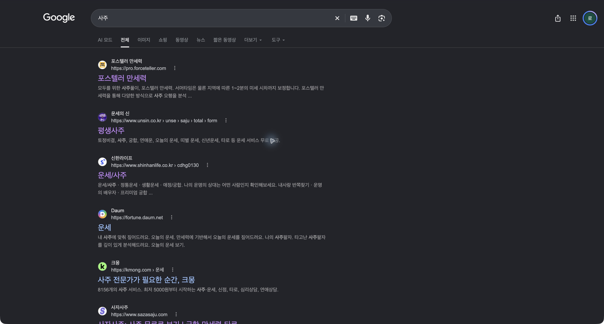

**화면 설명:** 첫 화면에서 포스텔러·운신 등 결과를 확인했다. 아래쪽 사자사주·사주아이까지는 검색 결과의 접근성 텍스트로 확인했다. Google 결과 설명에 사자사주는 가입 없이 무료라고 나오지만, 이번 체험은 사용자가 요청한 로그인 경로로 진행했다. 비로그인 무료 경로 전체는 별도 검증하지 않았다.

### 네이버 — 검색어 ‘사주’

네이버 비로그인 통합검색 표본에서는 상단 **‘사주 관련 광고’**에 사주나루, 사주천궁, 사주빌딩, 타이트사주, 무당닷컴, 천상장군명품김보살, 운온, 청월당, 홍카페, 송파작명이 이 순서로 나타났다. 이어 클립·브랜드 콘텐츠·정보 문서·쇼핑 영역이 섞였다. 이를 자연검색 서비스 순위로 환산하지 않았다. 청월당 광고의 247만 명 문구 역시 광고주 주장이다.

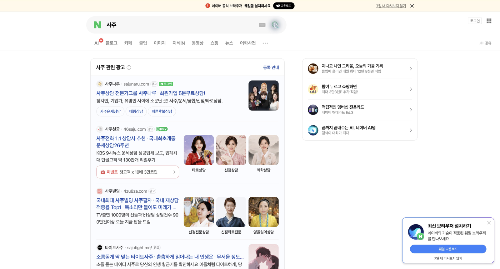

**화면 설명:** 검색 결과 상단부터 광고가 큰 비중을 차지한다. 자동 풀이 서비스와 전화 상담 서비스가 함께 경쟁한다. 신규 서비스는 Google 웹 검색 유입과 네이버 광고·콘텐츠 유입을 나눠 살펴보는 것이 적절하다.

## 사주아이: 저가 구매와 매일 돌아오는 고양이 브랜드

### 1. 홈과 상품 선택

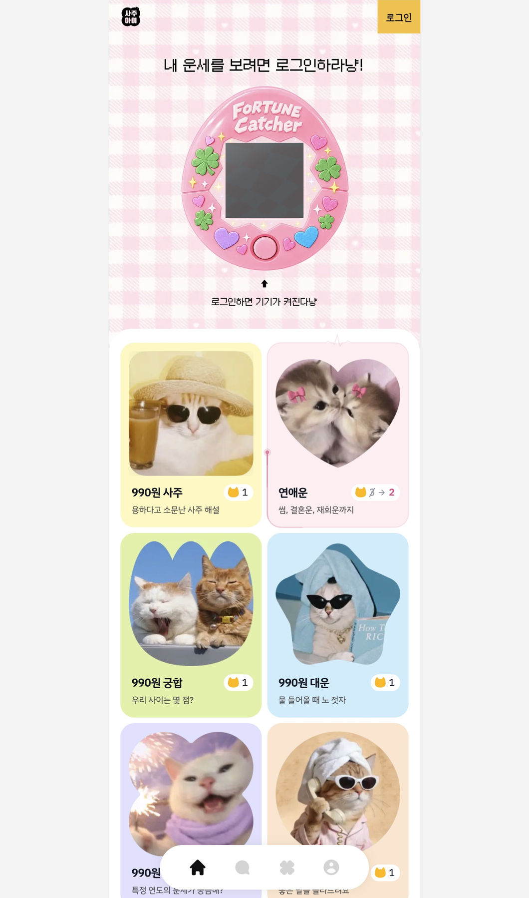

**기능:** 사주·궁합·대운·연운·택일을 990원 상품으로 제시하고, 연애운·무료 수다방·일일운세를 함께 배치한다. 하단에는 홈·수다방·일일운세·프로필 탐색이 있다.

**디자인:** 고양이 사진, 노란 포인트, 분홍 체크무늬 운세 뽑기 기계, 둥근 하단 메뉴가 눈에 띈다. 진지한 역술 서비스보다 친근한 놀이와 굿즈 같은 인상을 준다. 상품 이름에 가격을 반복해서 넣어 구매 부담을 작게 느끼도록 한다는 해석이 가능하다.

### 2. 소셜 로그인

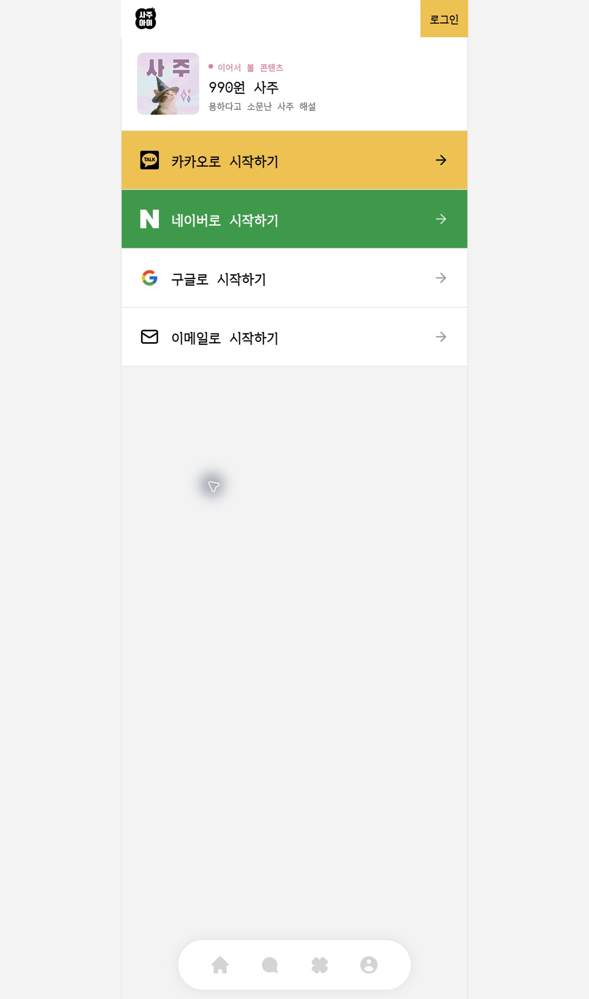

**기능:** 선택한 상품을 상단에 남기고 카카오·네이버·Google·이메일 로그인을 제공한다. 실제 Google 로그인 후 선택 상품 흐름으로 돌아왔다.

**디자인 판단:** 로그인 중에도 목적을 잊지 않게 한다. 다만 유료 상품은 입력·개인화 결과보다 로그인이 먼저여서 첫 방문자의 체험 진입에 마찰이 있다.

### 3. 프로필 입력과 명식 미리보기

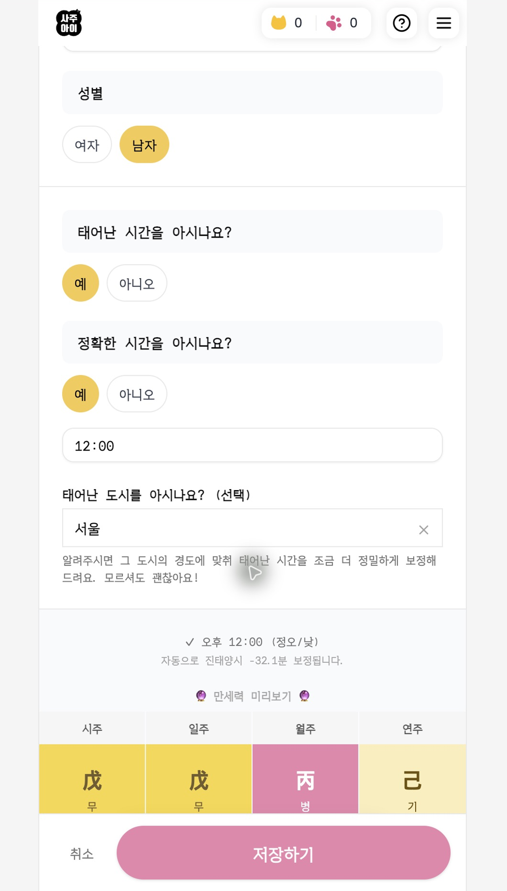

**기능:** 이름과 관계를 받은 뒤 생년월일·성별·출생 시간·선택 도시가 순차적으로 나타난다. 시간 모름과 정확한 시간 여부를 구분한다. 서울 선택 시 진태양시 −32.1분 보정 안내와 명식 미리보기가 표시됐다.

**디자인 판단:** 필요한 항목을 차례로 노출해 초기 부담을 줄인다. 만세력 미리보기는 입력 즉시 무언가 계산된다는 피드백이다. 저장 전에 수정이 어렵다는 확인 절차가 있어 오입력을 줄이지만, 저장 후 수정 제한은 부담이다.

### 4. 현재 고민을 선택적으로 받는 화면

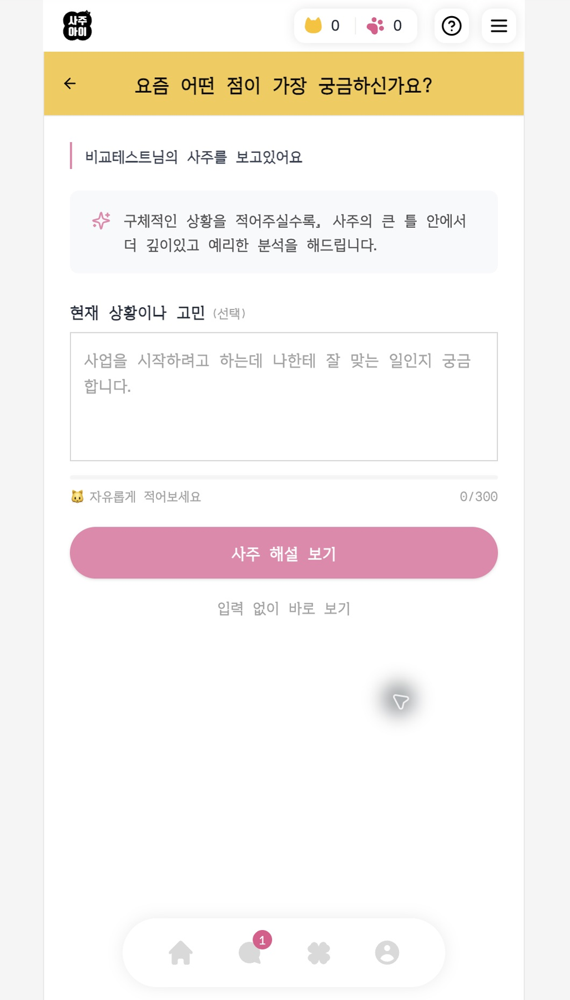

**기능:** 300자 이내 현재 상황·고민을 선택적으로 입력할 수 있다. 입력 없이 보기 버튼도 제공한다. 이번에는 가상의 고민을 추가하지 않고 건너뛰었다.

**디자인 판단:** 고정 생년월일 풀이에 현재 맥락을 더하는 위치가 명확하다. 어떤 정보가 답변을 개선하는지 안내하면서 필수 입력으로 만들지 않은 점을 참고할 만하다.

### 5. 구매 확인과 충전 가격표

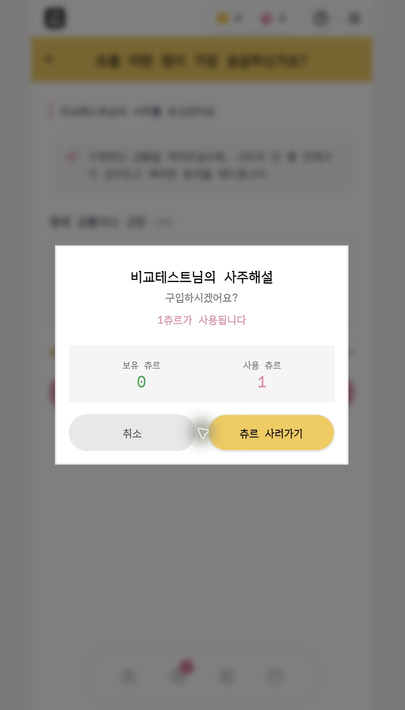

**기능:** 사주 해설에 1츄르가 필요하고 보유량은 0이라고 표시했다. 부족하면 충전으로 이동한다.

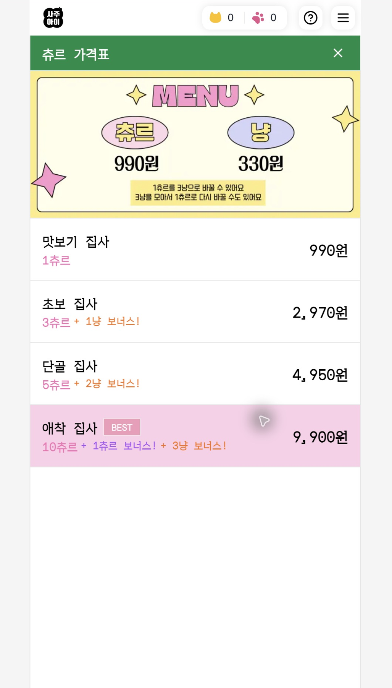

| 가격 | 화면상 제공량 |
|---|---|
| 990원 | 1츄르 |
| 2,970원 | 3츄르 + 1냥 보너스 |
| 4,950원 | 5츄르 + 2냥 보너스 |
| 9,900원 | 10츄르 + 1츄르 + 3냥 보너스 |

**디자인 판단:** ‘츄르·냥·집사’가 브랜드와 결제를 연결한다. 다만 서로 다른 재화의 사용처는 가격표만으로 완전히 이해하기 어렵다. 유료 사주 본문은 구매하지 않아 확인하지 못했다.

### 6. 무료 일일운세와 상세 리포트

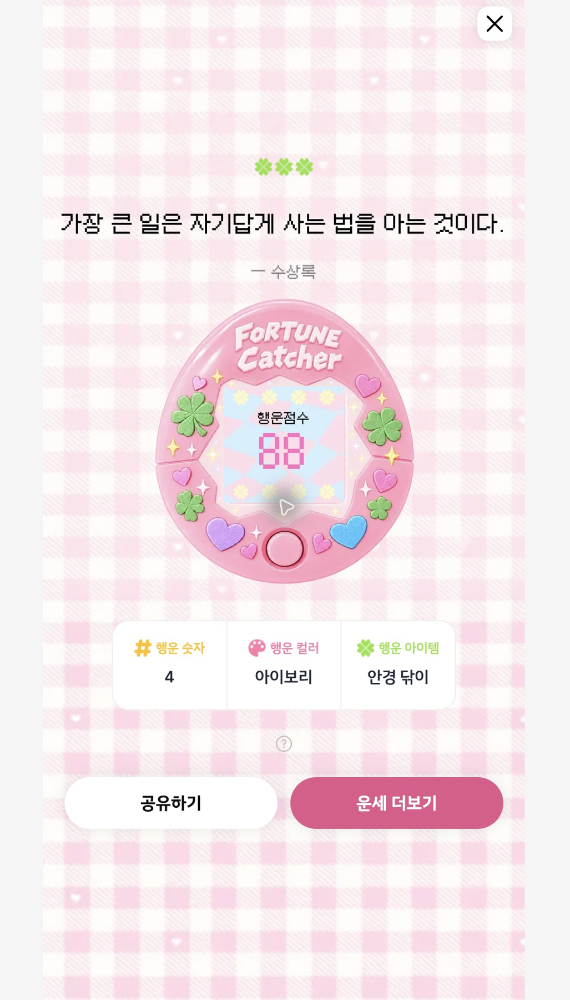

**기능:** 운세 뽑기에서 점수·문구·행운 숫자·컬러·아이템을 보여주고 상세 운세로 연결한다. 공유 버튼도 있다. 공유는 실행하지 않았다.

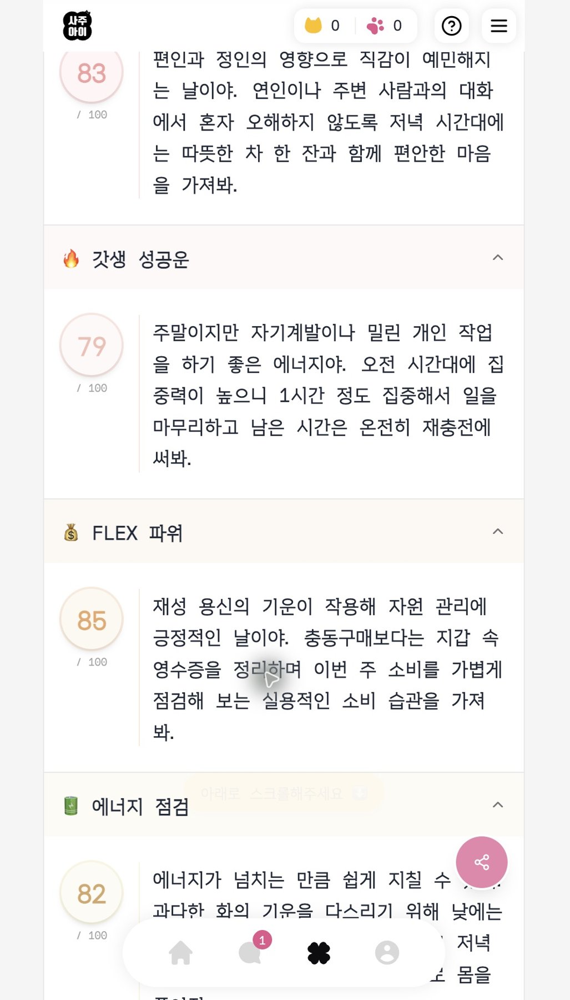

**기능:** 상세 운세는 기운 설명, 연애·성공·재물·에너지·학업·관계 점수, 오늘의 행동 제안, 음식·장소·행운 요소 등으로 구성된다. 연애 상태 입력도 선택 사항이며 건너뛰었다. 하단에 유료 상품 추천과 무료 수다방, 공유 링크·PDF 저장 기능이 표시됐다. 공유 링크 생성과 PDF 저장은 실행하지 않았다.

**디자인 판단:** ‘오늘 할 일’에 가까운 짧은 조언과 반복 무료 이용이 재방문 동기를 만든다. 명리 용어를 ‘갓생·FLEX·뇌지컬’ 같은 생활 언어로 바꾼다. 이와 별개로 실제 운세 정확도나 점수 계산의 타당성은 평가하지 않았다.

## 사자사주: 무료 설명에서 심층 분석으로 연결

### 1. 입력과 가입 완료

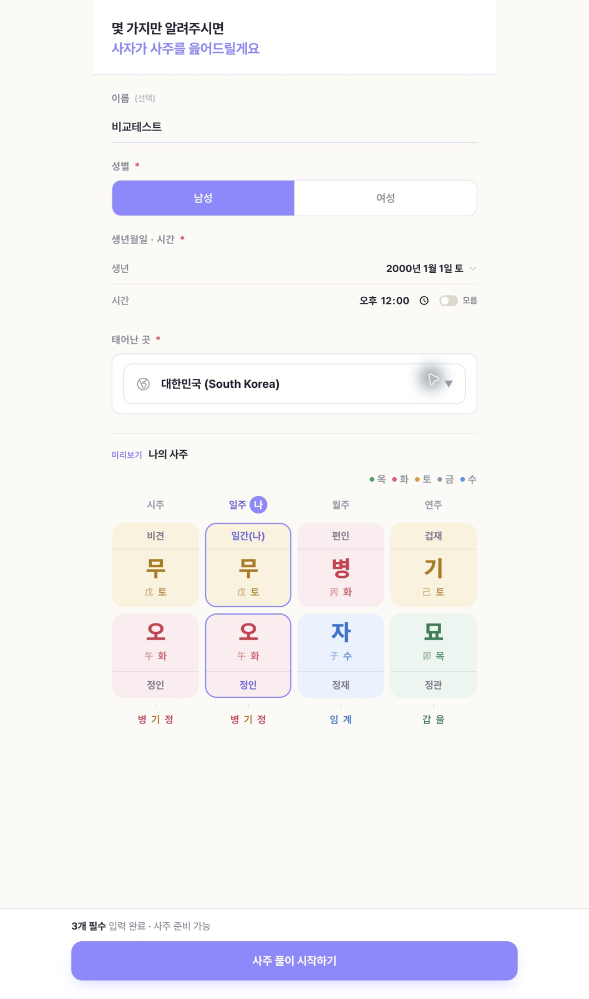

**기능:** 이름·성별·생년월일·시간·국가를 받고 입력 중 명식을 보여준다. 필수 항목 완료 상태와 하단 풀이 시작 버튼이 있다. 날짜 선택창의 기본 날짜는 화면에 보여도 실제 선택해야 완료로 인정됐다.

**디자인:** 아이보리 바탕, 흰 카드, 연보라 버튼, 넓은 간격, 작은 사자 캐릭터로 부드러운 인상을 준다. 데스크톱에서도 좁은 중앙 열을 사용한다.

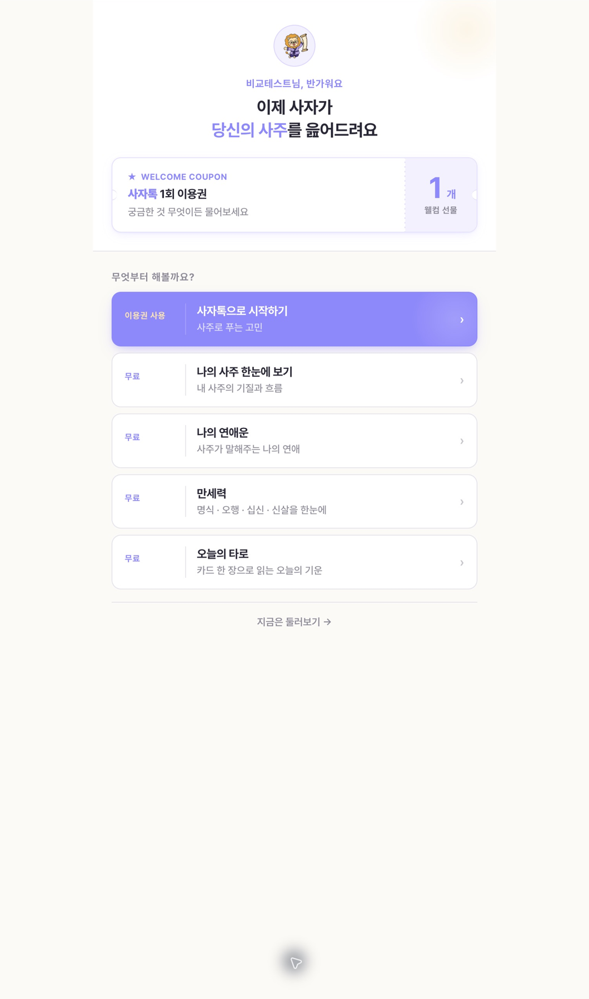

**기능:** 가입 후 사자톡 1회 이용권을 안내하고 무료 사주·연애운·만세력·오늘 타로 등 다음 행동을 제시한다. 이번에는 무료 사주를 선택했다.

### 2. 무료 사주 결과

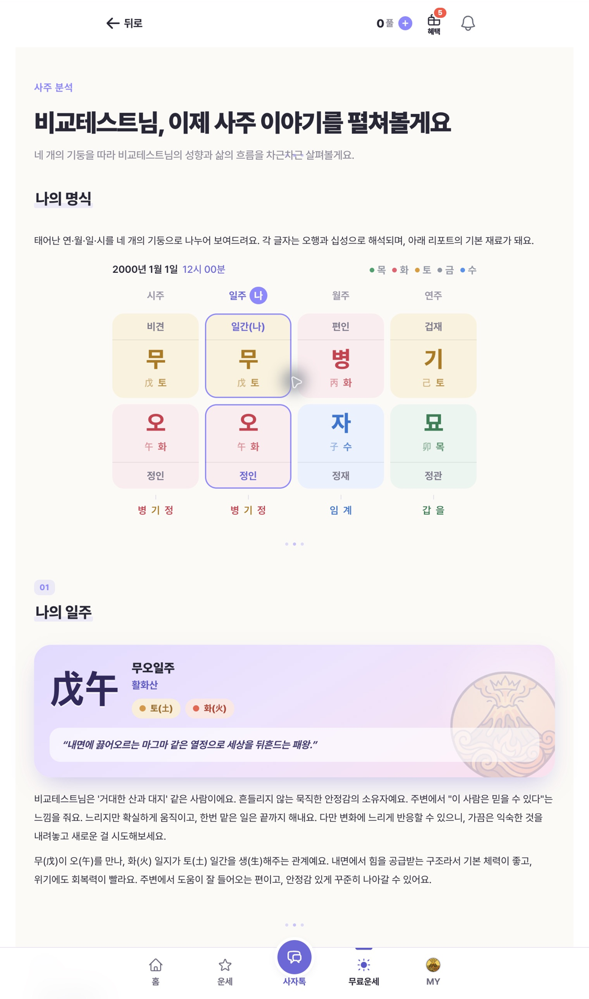

**기능:** 명식과 일주·오행·신살/길성·십성·12운성·격국·합충·관계 관련 설명이 이어진다. 비교 프로필은 무오일주로 계산됐다. 오행은 목13%·화38%·토38%·금0%·수13%로 표시됐다. 포스텔러의 12.5%·37.5% 수치와는 반올림 표현 차이가 있었다.

**디자인 판단:** 번호와 제목으로 긴 내용을 나누고, 일상적인 성격 설명을 제공해 초보자가 읽기 쉽다. 관련 주제 뒤에 채팅·심층 사주·재물·직업·궁합을 연결하는 흐름이 자연스럽다. 다만 길게 읽어야 하는 리포트이므로 요약·목차 이동이 중요하다.

### 3. 심층 분석 소개와 부족 재화 안내

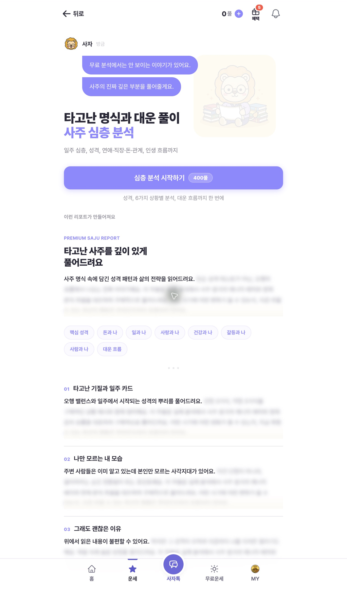

**기능:** 무료 분석 다음에 더 깊은 주제와 예시를 보여주고 **400풀** 심층 분석을 제안한다. 화면에는 여러 주제·샘플과 만족도·재이용률 주장이 있다.

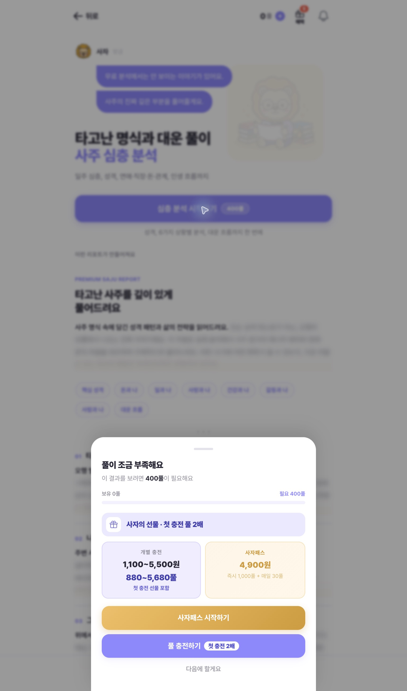

**기능:** 필요한 400풀과 보유 0풀을 표시한 뒤 충전 또는 패스를 선택하게 한다. 첫 충전 보너스를 강조한다.

**디자인 판단:** 무료 결과에서 느낀 호기심을 이어받으며 부족량과 다음 행동을 한 화면에서 설명한다. 그러나 원화와 재화가 분리되어 실제 한 번 구매 비용을 바로 계산하기는 어렵다.

### 4. 충전과 30일 패스

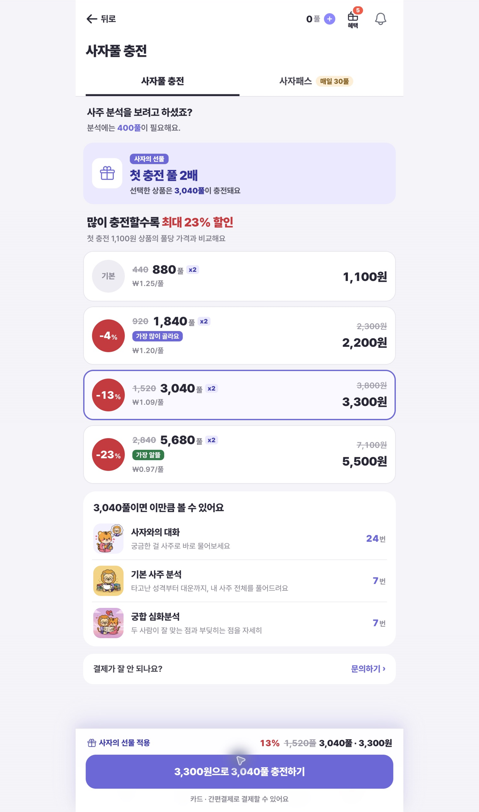

| 가격 | 기본 제공량 | 이번 화면의 첫 충전 혜택 적용량 |
|---|---|---|
| 1,100원 | 440풀 | 880풀 |
| 2,200원 | 920풀 | 1,840풀 |
| 3,300원 | 1,520풀 | 3,040풀 |
| 5,500원 | 2,840풀 | 5,680풀 |

3,300원 옵션이 미리 선택되어 있었다. 보너스 조건은 계정·시점에 따라 달라질 수 있으므로 상시 제공량으로 해석하지 않는다. 선택 재화로 가능한 채팅·사주·궁합 횟수를 함께 보여주는 점은 장점이다. 충전 실행 버튼은 누르지 않았다.

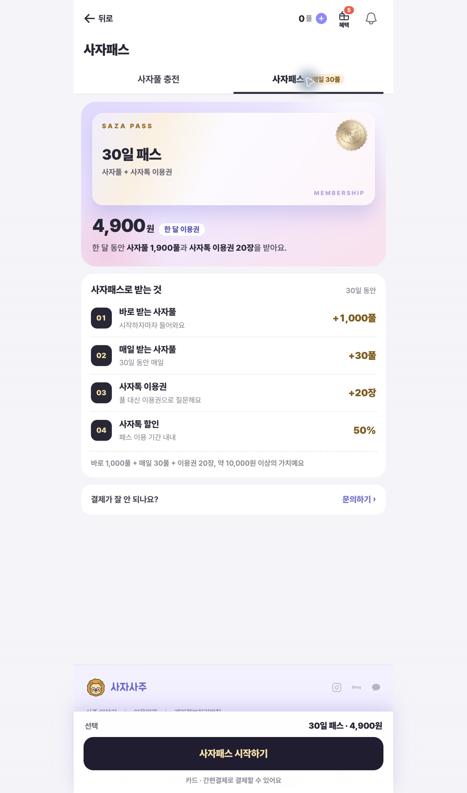

**기능:** 30일 패스 4,900원, 즉시 1,000풀·매일 30풀(총 1,900풀), 채팅 20회 이용권·채팅 50% 할인 등을 안내했다. **자동 갱신 여부는 확인하지 못했으므로 정기 구독이라고 단정하지 않는다.** 구매는 진행하지 않았다.

## 포스텔러 만세력: 계산 근거와 분석 도구

### 1. 서비스 소개

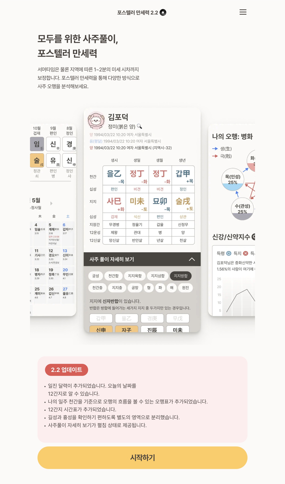

**기능:** 지역 시차·서머타임 보정과 다양한 오행 분석을 강조하고 바로 시작할 수 있다. 조사 화면 버전은 v2.2였다. **도메인의 pro를 유료 요금제라고 해석하면 안 된다.** 이번 핵심 만세력은 로그인·결제 없이 사용했다.

### 2. 입력과 시간 보정

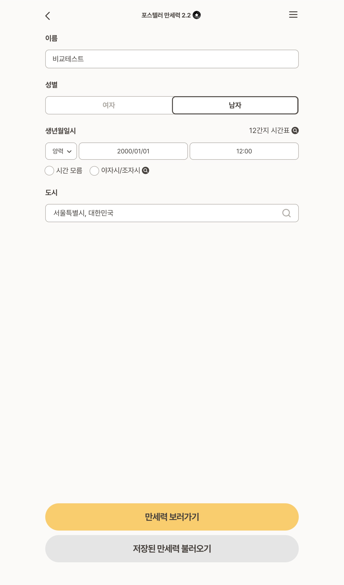

**기능:** 이름·성별·양력/음력·날짜·시간·출생 도시, 시간 모름과 야자시/조자시 옵션을 제공한다. 서울을 검색해 선택하니 확인 화면에서 −32분 보정을 표시했고, 결과는 입력 12:00에서 11:28로 보정됐다.

**디자인 판단:** 여러 계산 선택지를 제공해 숙련자에게 유용하다. 처음 보는 사람에게는 야자시·조자시 같은 용어가 장벽이 될 수 있다.

### 3. 명식과 관계 분석

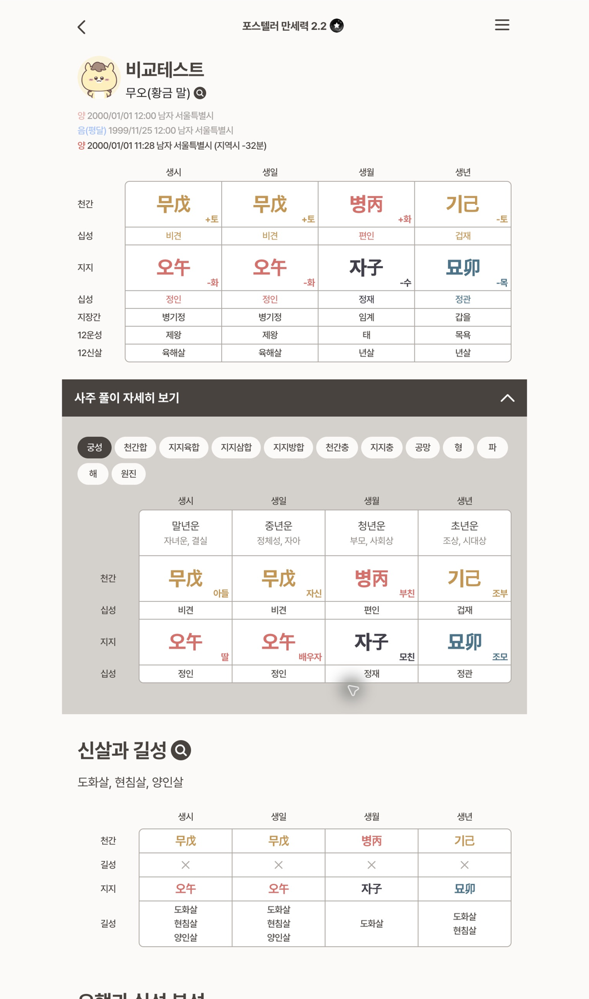

**기능:** 황금말 캐릭터와 무오일주, 명식·십성·지장간·12운성·12신살·신살/길성을 보여준다. 천간합·지지육합·삼합·방합·충·공망·형·파·해·원진 등 관계 분석을 선택적으로 확인한다.

**디자인:** 오행 색상과 표 중심의 밀도 높은 구성이다. 해석을 읽는 리포트보다 직접 분석하는 도구에 가깝다. 도중에 설치 안내와 상담 프로모션이 나타나 결과를 가려 닫아야 했다.

### 4. 오행·십성 시각화

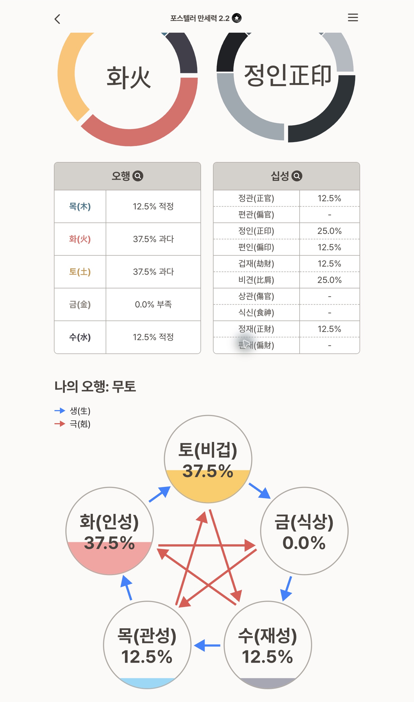

**기능:** 도넛 차트, 비율 표, 오행 관계도를 제공한다. 합에 따른 오행 변화 및 조후·궁성 보정 설정도 관찰했다.

**디자인 판단:** 숫자·색상·관계를 함께 보여줘 계산 결과를 검토하기 좋다. 초보자용 한 줄 설명을 함께 제공하면 접근성을 더 높일 수 있다. 전체 분석 옵션의 계산 정확도를 검증한 것은 아니다.

## 젠디: 사주를 캐릭터와 웹툰으로 체험

### 1. 카탈로그

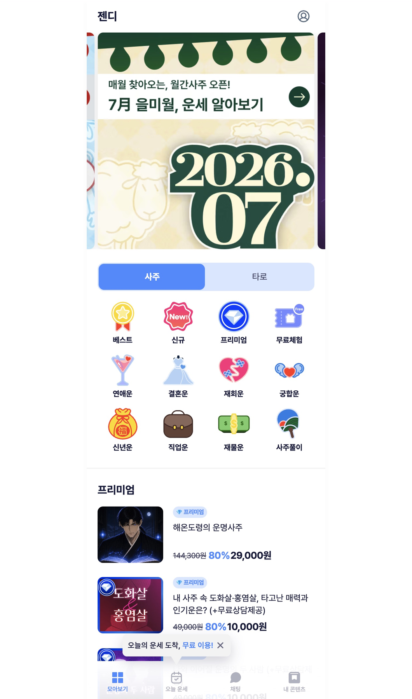

**기능:** 사주·타로 탭, 베스트·신규·프리미엄·무료체험·연애·결혼·궁합·직업·재물 등 카테고리와 콘텐츠 목록을 제공한다. 하단은 모아보기·오늘운세·채팅·내콘텐츠로 구성된다. ‘해온도령의 운명사주’는 원가 표시 144,300원에서 할인 가격 **29,000원**으로 나타났다. 실제 결제 금액과 적용 조건은 결제창에서 확인하지 못했다.

**디자인 판단:** 여러 콘텐츠를 고르는 엔터테인먼트 앱처럼 보인다. 많은 카테고리는 탐색에 유리하지만, 첫 방문자의 대표 상품 선택은 더 단순하게 만들 여지가 있다.

### 2. 캐릭터 상품 소개

**기능:** 해온도령 캐릭터가 전면에 등장하고 체험 시작을 유도한다. 스토리 진행률과 건너뛰기가 제공됐다.

**디자인:** 검정·짙은 남색, 푸른 발광 효과, 크게 그린 남성 캐릭터가 몰입감을 만든다. 같은 홈에서 상품으로 들어가면 시각 분위기가 크게 바뀌어 콘텐츠별 세계관을 구분한다.
 
### 3. 한 번에 한 질문씩 입력

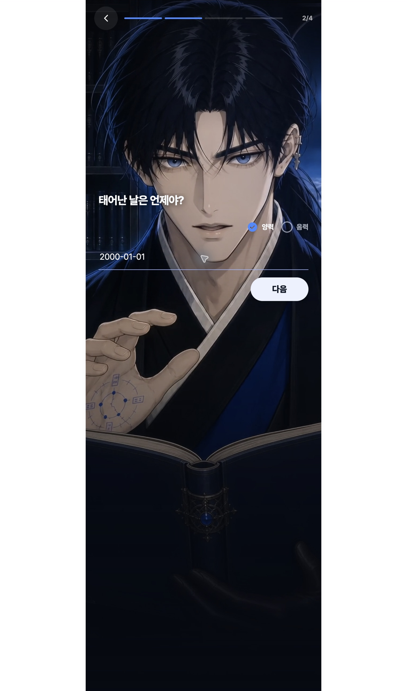

**기능:** 이름 → 양력/음력·생년월일 → 출생 시간/모름 → 성별을 4단계로 받는다. 날짜를 숫자로 입력하면 날짜 형식으로 변환된다. 이 체험 경로에서 별도 로그인 조작 없이 개인화 미리보기까지 도달했다.

**디자인 판단:** 질문이 캐릭터의 대화처럼 보여 설문 부담을 줄인다. 반면 입력을 한눈에 비교·수정하기에는 한 화면 폼보다 불편할 수 있다.

### 4. 개인화 웹툰과 잠긴 정보

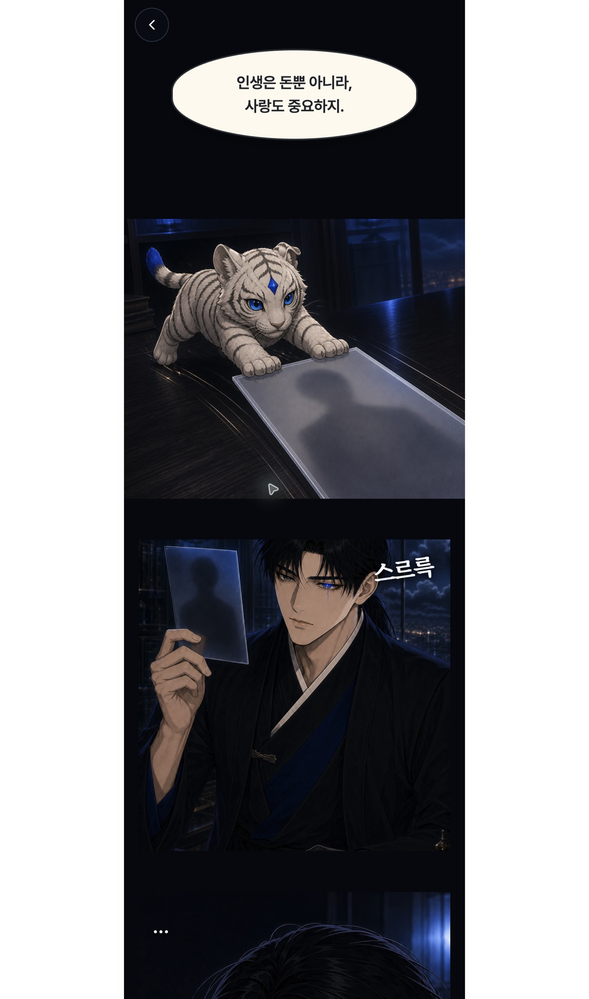

**기능:** 이름을 부르며 명식·성격 풀이를 웹툰의 대사와 기록 카드로 전달한다. 일부 성격 설명을 공개하고 대운·재물·운명의 짝 얼굴과 시기 등의 정보를 흐리게 가린다. 전체 상품은 14개 기록·50가지 풀이를 약속한다. 이는 판매 소개상의 분량이며 유료 결과를 검증한 수치가 아니다.

**디자인 판단:** 인물·동물 캐릭터·말풍선·카메라 구도 변화가 일반 텍스트 리포트와 차별화된다. 잠긴 정보는 궁금증을 만들지만 웹툰이 매우 길어 다음 행동까지 도달하는 시간이 길다. 이미지가 나타나는 연출 구간에는 큰 빈 공간도 보였다.

### 5. 후기·규모와 마지막 화면

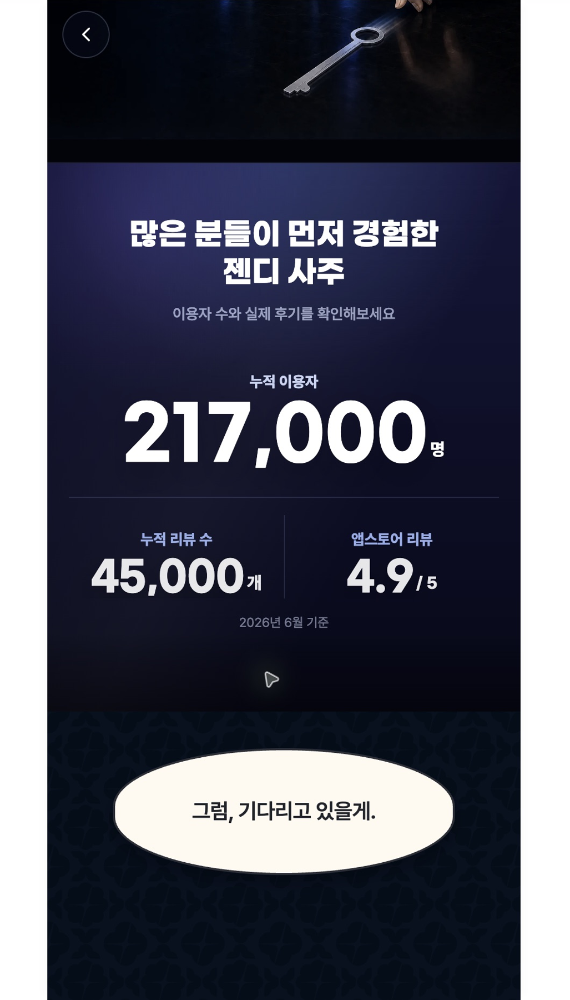

**기능:** 후기와 이용자·리뷰 규모를 제시하고 캐릭터의 마지막 대사로 끝난다. 화면상 이용자 217,000명·리뷰 45,000개·앱스토어 4.9/5는 2026년 6월 기준 자체 표시다.

**체험 한계:** 스크롤을 끝까지 내렸지만 이번 경로에서는 구매·로그인 버튼이 표시되지 않았다. 따라서 젠디는 **미리보기까지 사용했으며 결제 직전 화면까지 확인한 것으로 기록하지 않는다.** 원인을 특정하지 않았으며 다른 상품·앱 경로에도 동일하다고 단정하지 않는다.

## 운신: 무료 운세·유료 카탈로그·광고가 함께 있는 포털

### 1. 홈

**기능:** 신년·월간·만남·짝사랑·궁합·연애고민·오늘운세·1:1상담 등 많은 메뉴를 제공한다. 운영사는 화면 하단에 스포츠조선으로 표시된다.

**디자인:** 넓은 데스크톱 레이아웃, 큰 배너와 다수 상품, 광고가 특징이다. 좁은 중앙 열의 신생 서비스들과 달리 전통적인 콘텐츠 포털의 인상이 강하다.

### 2. 무료 평생사주 입력

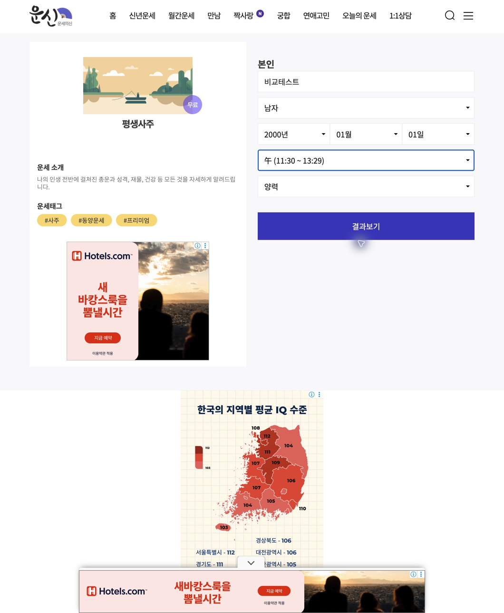

**기능:** 이름·성별·년월일·출생 시간대·양력/음력을 한 화면에서 받는다. 12:00에 해당하는 午(11:30~13:29)를 선택했다. 이번 무료 경로에서 Google 로그인은 필요하지 않았다.

**디자인 판단:** 상품 설명과 입력을 좌우로 배치해 목적과 양식을 동시에 보여준다. 연도·월·일 드롭다운은 명확하지만 긴 연도 목록은 입력 비용이 있다. 광고가 입력 영역 주변에도 존재한다.

### 3. 광고 후 무료 결과

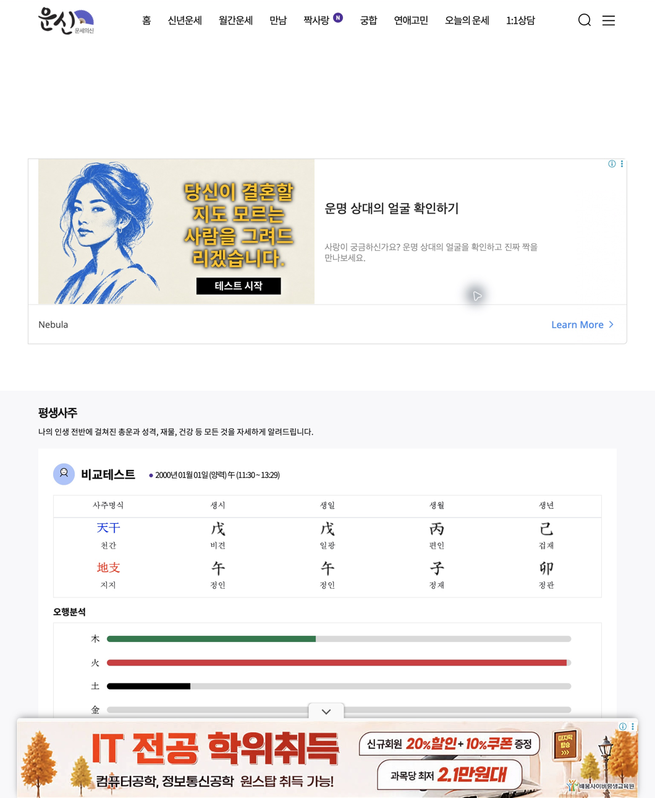

**기능:** 결과보기를 누르자 광고 화면이 나타난 뒤 무료 결과로 이동했다. 명식·오행 그래프와 총평, 초년·중년·말년, 성격·관계·재물 등 여러 설명을 제공한다.

**디자인 판단:** 무료로 제공하는 본문량은 많다. 그러나 긴 문단 중심이며 광고가 화면 상단·하단에 노출되어 집중을 방해한다. 같은 결과 안에서 주제별 설명의 일관성도 별도로 점검할 필요가 있다. 실제 예측·건강·재테크 내용의 타당성을 평가한 것은 아니다.

### 4. 유료 상품 소개와 입력

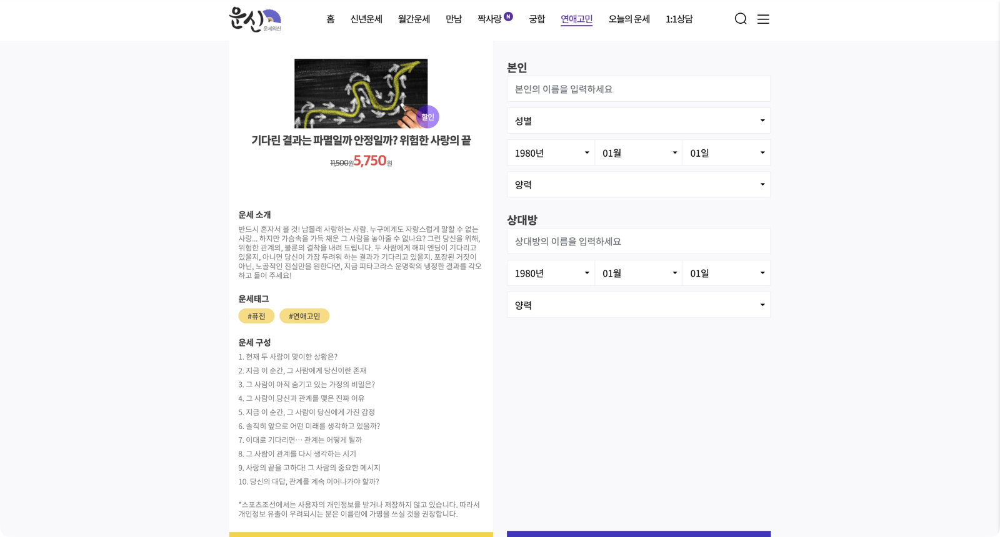

**기능:** 관찰한 유료 상품은 연애고민에 관한 **피타고라스 운명학/퓨전 운세**다. 전통 사주 상품으로 분류하지 않는다. 11,500원에서 5,750원으로 할인 표시하며 목차·샘플 안내와 본인·상대방 입력란을 제공한다. [해당 상품](https://fortun.unsin.co.kr/intro.php?cid=1985)

**체험 한계:** 유료 상품의 소개·가격·입력 화면까지 확인했다. 본인·상대방 정보를 추가 제출하거나 결제창에 들어가지는 않았다. 이 가격은 운신 전체 상품의 공통 요금이 아니다.

## 추가 후보 목록

아래는 후속 조사 후보다. 이번 5개 서비스의 직접 체험과 구분하며, 추가 후보의 로그인·결제·모바일 화면은 이번 문서에서 직접 검증하지 않았다. 검색 광고에 노출된 경우는 별도로 표시했다.

| 서비스 | 링크 | 비교할 이유 / 이번 확인 |
|---|---|---|
| 청월당 | [사이트](https://cheongwoldang.com/) | 자동 풀이 후보, 네이버 광고 노출 |
| 타이트사주 | [사이트](https://www.sajutight.me/) | 자동 풀이 후보, 네이버 광고 노출 |
| 도사 | [사이트](https://dosa.gkuer.com/) | 주제별 자동 풀이 비교 후보 |
| 헬로우봇 | [사이트](https://hellobot.co/) | 캐릭터·대화형 콘텐츠 비교 후보 |
| 소연 | [사이트](https://sajuai.io/ko) | AI 사주 비교 후보 |
| 사주몰 | [사이트](https://www.sajumol.com/) | 온라인 사주 상품 비교 후보 |
| 사주시트 | [사이트](https://sajusheet.com/) | 리포트 방식 비교 후보 |
| 사주마마 | [사이트](https://sajumama.com/ko) | 온라인 자동 풀이 비교 후보 |
| 사주여울 | [사이트](https://sajuyeoul.com/) | 온라인 풀이 비교 후보 |
| 명류사주 | [사이트](https://www.myungryusaju.com/) | 온라인 풀이 비교 후보 |
| 사주나루 | [사이트](https://www.sajunaru.com/) | 사람 상담 플랫폼; 네이버 광고·사업 실적 기사 |
| 사주천궁 | [사이트](https://www.46saju.com/) | 사람 상담 플랫폼; 네이버 광고·사업 실적 기사 |
| 천명 | [사이트](https://chunmyung.com/) | 사람 상담 플랫폼 비교 후보 |
| 홍카페 | [사이트](https://www.hongcafe.com/) | 사람 상담 플랫폼; 네이버 광고 노출 |

Google 검색에서 발견한 신한라이프·Daum·아시아경제는 무료 검색 유입 경쟁 대상으로, 크몽은 전문가 상담 거래 대상으로 추가할 수 있다. 젠디처럼 앱과 웹을 함께 운영하는 서비스는 웹 성과를 앱 전체 성과와 나누어 봐야 한다.

## 제품 설계에 적용할 포인트

| 목적 | 참고 서비스 | 적용 아이디어 |
|---|---|---|
| 첫 결제 부담 낮추기 | 사주아이 | 원화 기준으로 이해하기 쉬운 작은 단위 상품 |
| 무료 결과로 신뢰 만들기 | 사자사주 | 개인화된 요약을 먼저 주고 바로 관련 유료 주제를 연결 |
| 매일 돌아올 이유 제공 | 사주아이 | 일일운세·무료 대화 기회·짧은 행동 제안 |
| 감성적 차별화 | 젠디 | 캐릭터와 시각 연출을 쓰되 건너뛰기·요약·명확한 구매 버튼 유지 |
| 계산 근거 설명 | 포스텔러 | 입력 시각·보정 시각을 함께 표시하고 상세 옵션은 점진 노출 |
| 가격 이해 돕기 | 사자사주·사주아이 | 포인트 가격 옆에 이번 상품의 원화 비용·보너스 조건·잔액 표시 |
| 결과 가독성 | 5개 비교 | 긴 문단을 요약·카드·목차로 나누고 광고·프로모션의 방해 최소화 |

입력 흐름과 일주·오행 결과는 비교했지만, 같은 입력을 여러 번 반복하는 재현성 시험이나 사주 계산 알고리즘 검증은 하지 않았다. 이번 자료는 **웹 서비스의 기능·화면·구매 동선 벤치마크**로 사용하면 된다.

## 남아 있는 확인 항목

- 비개인화 검색, ‘무료 사주’·‘AI 사주’·‘사주 사이트’ 등 추가 키워드 및 여러 날짜의 노출 비교.
- 젠디 미리보기 뒤 구매 버튼이 나타나지 않은 원인과 다른 상품의 로그인·결제 흐름.
- 운신 유료 사주 상품 자체의 결제 전 흐름. 이번 유료 표본은 퓨전 연애 운세였다.
- 실제 모바일 화면, 유료 결과 본문, 고객 지원·환불·재열람·정보 수정 흐름.
- 서비스별 매출·월간 활성 사용자·유료 전환율의 독립적 근거.

